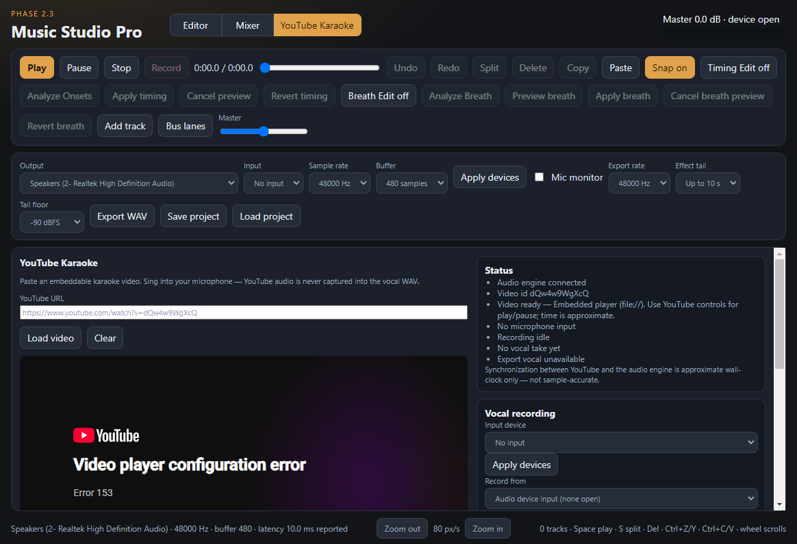

# Karaoke K1 — YouTube Player & Vocal Recording

**Status:** complete — awaiting approval before K2/K3  
**Baseline:** Phase 2.6 + EngineHost EPIPE fix APPROVED

## 1. Verdict

A dedicated **YouTube Karaoke** tab lets users paste an embeddable YouTube URL, play the video in an isolated iframe, select a mic / virtual input, arm and record vocals through the existing native pipeline, review takes, export vocal WAV (with video-id / position metadata sidecar), and optionally import authorized local backing audio for mix export. YouTube audio is never captured into the vocal WAV. No K2/K3 features were implemented.

## 2. YouTube integration architecture

| Piece | Implementation |
| --- | --- |
| Tab | `view: 'karaoke'` beside Editor / Mixer |
| URL parse | `parseYoutubeVideoId` — watch, youtu.be, shorts, embed, bare id |
| Player | Official YouTube IFrame Player API when origin is `http(s)`; plain `youtube.com/embed` on Electron `file://` |
| Controls | Load / Clear; Play / Pause when API available; YouTube chrome on embed fallback |
| Status | idle / loading / ready / playing / paused / ended / unavailable / error |

Remote YouTube content runs only inside the iframe. It has **no** access to `window.studio`, Node, or the native engine.

## 3. Recording flow

1. Paste URL → Load video  
2. Select input device (or virtual test signal) → Apply devices  
3. Ensure **Karaoke Vocal** track (created/armed automatically)  
4. Optional: Monitor / Live Auto-Tune (existing panel)  
5. Start Recording — stamps `videoId` + approximate video position  
6. Stop Recording — take WAV via existing `record` / `finishRecording`  
7. Export Vocal WAV — copies take + writes `.karaoke.json` sidecar  
8. Optional: Import backing WAV onto **Karaoke Backing** → Export mix WAV  

**Vocal WAV contains microphone (or virtual) input only.** YouTube playback stays in Chromium and is never mixed into the take.

## 4. Electron security measures

- `contextIsolation: true`, `nodeIntegration: false`, `sandbox: true`
- Preload exposes only the existing `studio` bridge (+ `exportKaraokeVocal`)
- Main-frame navigation limited to `file:`; https popups open externally via `shell.openExternal`
- Chromium permission requests denied (mic capture is native JUCE, not `getUserMedia`)
- CSP widened only for YouTube script/frame/img/connect hosts (`youtube.com`, `youtube-nocookie.com`, `s.ytimg.com`, `i.ytimg.com`)
- EngineHost EPIPE protections reused for disconnect resilience

## 5. Synchronization limitations

- Video position at record start is **wall-clock / player-reported**, not sample-accurate to JUCE.
- Timestamps are recorded and shown; they are **not** silently rewritten to hide drift.
- On `file://`, play/pause/time may rely on YouTube’s own embed UI (IFrame API unreliable).

## 6. Export behavior

| Action | Behavior |
| --- | --- |
| Export Vocal WAV | Copies last take WAV; writes sibling `.karaoke.json` (`videoId`, `videoPositionSec`, `recordedAt`) |
| Import backing | Existing `importClip` onto Karaoke Backing track |
| Export mix WAV | Existing `exportWav` — vocal + local tracks only (no YouTube audio) |

## 7. Files changed

**Renderer**

- `apps/desktop/renderer/src/KaraokePanel.tsx` (new)
- `apps/desktop/renderer/src/YouTubePlayer.tsx` (new)
- `apps/desktop/renderer/src/youtubeUrl.ts` (re-export)
- `apps/desktop/renderer/src/App.tsx` — Karaoke tab
- `apps/desktop/renderer/src/styles.css`
- `apps/desktop/renderer/src/studio.d.ts`
- `apps/desktop/renderer/index.html` — CSP

**Electron**

- `apps/desktop/electron/youtubeUrl.ts` (new)
- `apps/desktop/electron/karaokeK1Check.ts` (new) — `MSP_KARAOKE_K1_CHECK`
- `apps/desktop/electron/main.ts` — tab check hook, `karaoke:exportVocal`, popup/permission hardening
- `apps/desktop/electron/preload.ts` — `exportKaraokeVocal`

**Shared**

- `packages/shared/src/youtubeUrl.ts` (new)

**Docs**

- `docs/karaoke-k1-final-report.md` (this file)
- `docs/karaoke-k1-screenshots/`

No native engine rewrite; no schema migration.

## 8. Screenshots




## 9. Exact tests executed

```
Executed:
- npx tsc -p tsconfig.json --noEmit (apps/desktop): exit 0
- npx tsc -p tsconfig.electron.json --noEmit (apps/desktop): exit 0
- npm run build (apps/desktop): exit 0
- MSP_KARAOKE_K1_CHECK=docs\karaoke-k1-screenshots: 26 PASS, 0 FAIL, 1 NOT RUN, exit 0

Not run: full regression, prior-phase native/GUI suites, installer/packaging
Native suites: NOT RUN (no native code changes)
Microphone: NOT RUN — NO HARDWARE
```

### `MSP_KARAOKE_K1_CHECK` (26 PASS, 1 NOT RUN)

URL validation/parsing, embed URL, engine disconnect without EPIPE, virtual-input record start/stop, take persistence, video metadata sidecar, vocal export copy, backing import, mix export, source WAV protection, Karaoke tab/UI, CSP hosts, isolation (studio without `require`), player lifecycle handled (`ready`), non-crashing player path, no uncaughtException. Microphone NOT RUN.

## 10. Known limitations

- Not sample-accurate YouTube↔engine sync.
- `file://` uses plain embed; full IFrame API play/pause/time when served over http(s).
- Some videos may show YouTube embed error 153 under `file://` (referrer/embed policy); architecture still isolates the iframe and records vocals independently.
- Embedding can still be disabled by the video owner (shown as unavailable).
- No YouTube audio download, stream interception, DRM bypass, or WASAPI loopback.
- K2/K3 (lyrics sync, scoring, etc.) not implemented.

## 11. Stop

Karaoke K1 complete. Waiting for approval before K2 or K3.
