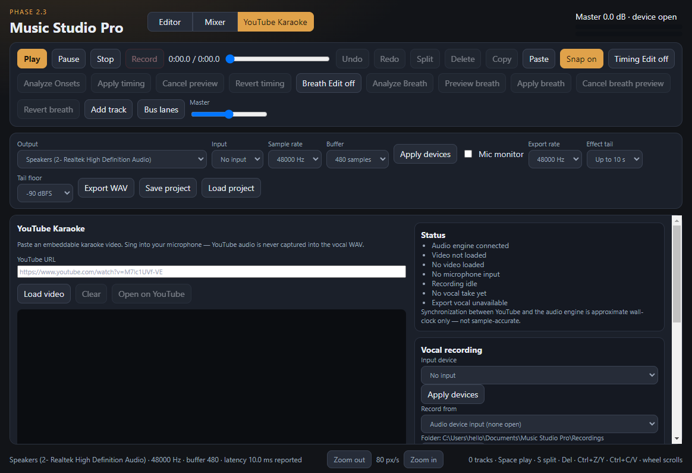
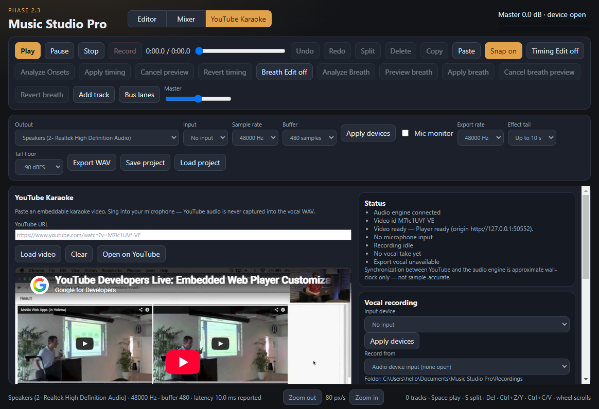

# Karaoke K1.1 — YouTube Embed Compatibility

**Status:** complete — STOP (do not begin K2/K3)  
**Baseline:** Karaoke K1 APPROVED (tab, iframe player, mic/record/export); known limitation was Error 153 under `file://`

## 1. Verdict

Error **153** under `file://` is real and is caused by a missing HTTP Referer / non-http(s) embedder origin. Music Studio Pro now serves the renderer from a loopback **`http://127.0.0.1:<ephemeral>`** origin so Chromium sends a natural Referer. The official YouTube IFrame Player API reaches **`ready`** with a live embeddable sample video. No Referer spoofing, no security bypasses, and no embedding-restriction circumvention.

**Real YouTube playback verified:** yes — `M7lc1UVf-VE` (Google IFrame API sample) → status `ready`, origin `http://127.0.0.1:50552`.

## 2. Root cause (Error 153)

| Factor | Under `file://` | Under `http://127.0.0.1` |
| --- | --- | --- |
| Document origin | opaque / `file://` | `http://127.0.0.1:<port>` |
| Referer to youtube.com | typically absent | sent by Chromium |
| YouTube embedder identity | rejected → Error 153 | accepted for embeddable videos |

YouTube’s own help text requires embedders to provide an HTTP Referer; missing Referer surfaces Error 153. This matches K1 observations and is fixed by a real HTTP application origin — not by header spoofing.

## 3. Fix architecture

| Piece | Behavior |
| --- | --- |
| Local renderer server | `localRendererServer.ts` — binds `127.0.0.1:0`, GET/HEAD only, Host allowlist, path-traversal guard, `X-Frame-Options: DENY`, `nosniff` |
| Main window load | `loadURL(http://127.0.0.1:<port>/)` instead of `loadFile` |
| Navigation | `will-navigate` allows only the app origin; https popups → `shell.openExternal` |
| Player | Official IFrame API; iframe built with `referrerpolicy=strict-origin-when-cross-origin`, `origin` + `widget_referrer` = document origin |
| `file://` | Explicitly refused in `YouTubePlayer` with a clear unavailable message |
| Embed denied | Banner + **Open on YouTube** (`karaoke:openExternal`, https YouTube hosts only) |
| Isolation | `contextIsolation`, `sandbox`, no `nodeIntegration`; remote iframe has no `window.studio` |

## 4. Files changed

**Electron**

- `apps/desktop/electron/localRendererServer.ts` (new)
- `apps/desktop/electron/karaokeK11Check.ts` (new) — `MSP_KARAOKE_K11_CHECK`
- `apps/desktop/electron/main.ts` — HTTP load, origin navigation, `karaoke:openExternal`, K11 hook
- `apps/desktop/electron/preload.ts` — `openYoutubeExternal`
- `apps/desktop/electron/youtubeUrl.ts` — embed helper default origin `http://127.0.0.1`

**Renderer**

- `apps/desktop/renderer/src/YouTubePlayer.tsx` — http(s)-only API path, error mapping (incl. 153), iframe + referrer policy
- `apps/desktop/renderer/src/KaraokePanel.tsx` — Open on YouTube, embed-error banner, app-origin label
- `apps/desktop/renderer/src/studio.d.ts`
- `apps/desktop/renderer/index.html` — CSP connect/media for YouTube CDNs

**Shared**

- `packages/shared/src/youtubeUrl.ts` — embed helper default origin

**Docs**

- `docs/karaoke-k11-final-report.md` (this file)
- `docs/karaoke-k11-screenshots/`

No native engine changes. No packaging.

## 5. Screenshots





Player screenshot shows Google’s sample video embedded with status:  
`Video ready — Player ready (origin http://127.0.0.1:50552).`

## 6. Exact tests executed

```
Executed:
- npx tsc -p tsconfig.json --noEmit (apps/desktop): exit 0
- npx tsc -p tsconfig.electron.json --noEmit (apps/desktop): exit 0
- npm run build (apps/desktop): exit 0
- MSP_KARAOKE_K11_CHECK=docs\karaoke-k11-screenshots
  (electron --user-data-dir=docs\karaoke-k11-screenshots\electron-user-data):
  22 PASS, 0 FAIL, 1 NOT RUN, exit 0
  origin=http://127.0.0.1:50552

Not run: full regression, Karaoke K1 re-suite, other GUI checks, native tests
Native suites: NOT RUN (no native code changes)
Microphone: NOT RUN — NO HARDWARE
```

### `MSP_KARAOKE_K11_CHECK` (22 PASS, 1 NOT RUN)

| Scenario | Result |
| --- | --- |
| resolve index.html | PASS |
| resolve nested asset | PASS |
| reject path traversal | PASS |
| reject missing file | PASS |
| local server serves index | PASS |
| local server sets nosniff | PASS |
| local server denies framing | PASS |
| local server rejects bad Host | PASS |
| error 153 maps to unavailable | PASS |
| error 101 maps to unavailable | PASS |
| error 2 maps to invalid id | PASS |
| appOrigin is http 127.0.0.1 | PASS |
| renderer document uses http origin | PASS |
| renderer is not file:// | PASS |
| Karaoke UI shows open-external control | PASS |
| Karaoke UI shows app origin | PASS |
| player initialization reaches terminal/handled state | PASS (`ready`) |
| iframe uses youtube embed host | PASS |
| no Error 153 under http origin | PASS |
| real YouTube playback path (ready/playing) | PASS (`ready`) |
| embed error banner when not playable | PASS |
| player cleanup on clear | PASS |
| live microphone | NOT RUN — NO HARDWARE |

## 7. Confirmed limitations

- Videos whose owners disable embedding still fail (YouTube 100/101/150). UI shows a banner and **Open on YouTube**; vocals can still be recorded.
- Age-restricted / region-blocked / network-blocked videos are not forced playable.
- Running a second Electron instance against the **same** Chromium user-data directory can corrupt the disk cache and produce false embed failures; GUI checks should use a dedicated `--user-data-dir` when another MSP window is already open.
- YouTube↔engine sync remains approximate wall-clock only (unchanged from K1).
- No Referer spoofing, no YouTube download/stream interception, no DRM/WASAPI loopback bypass.
- K2/K3 not started.

## 8. Security preservation

- `contextIsolation: true`, `nodeIntegration: false`, `sandbox: true`
- Local server: loopback bind, Host validation, no directory traversal, no remote content serving
- Main-frame navigation locked to app origin
- `openYoutubeExternal` validates `https:` + YouTube hostnames only
- Chromium permission requests still denied (mic remains native JUCE)

## 9. Stop

Karaoke K1.1 complete. Waiting for approval before K2 or K3.
