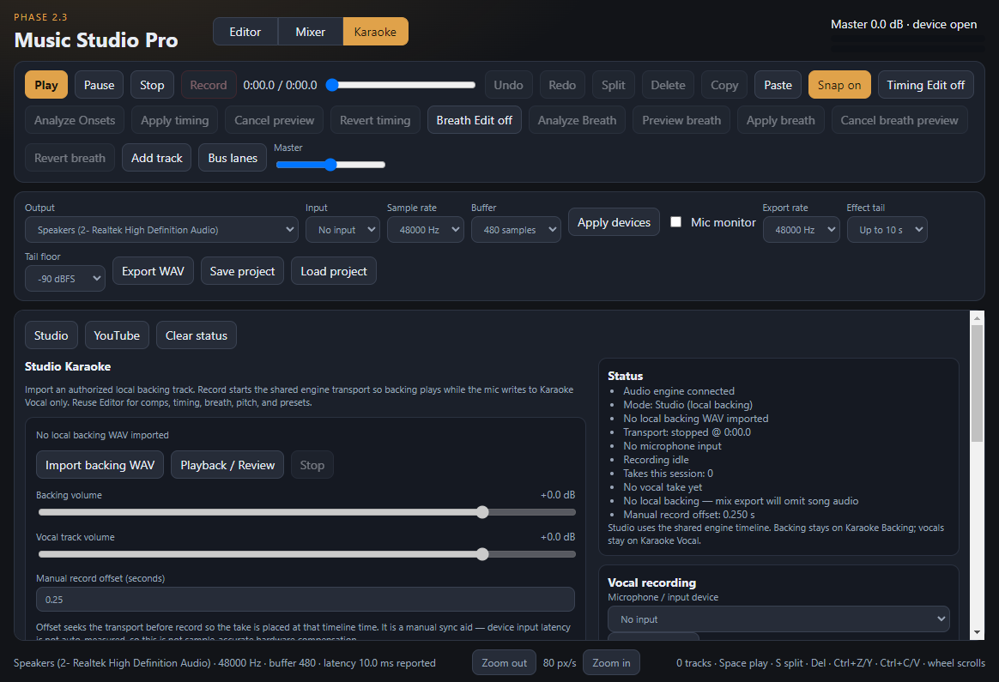
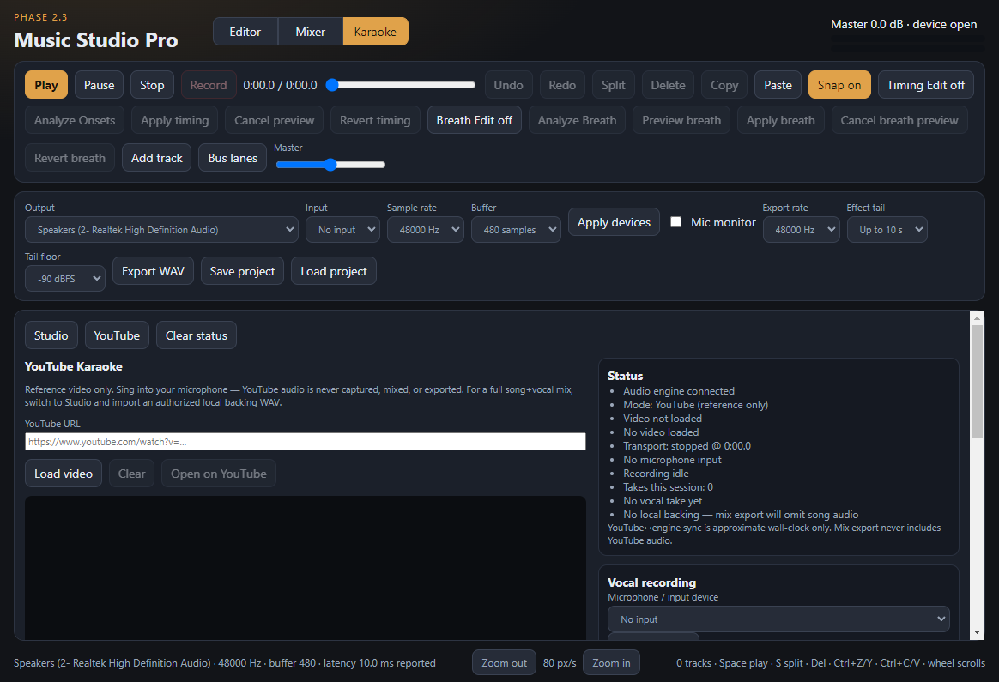

# Karaoke K2 — Studio Recording & Full Mix Export

**Status:** complete — STOP (do not begin K3)  
**Baseline:** Karaoke K1 + K1.1 APPROVED

## 1. Verdict

Studio Karaoke reuses the existing native engine for **record-with-playback**, multi-take placement, track volumes/FX, and full mix `exportWav`. The Karaoke UI now has **Studio** and **YouTube** modes. Local backing plays on the shared transport while the mic writes only to **Karaoke Vocal**. YouTube audio is never captured or mixed.

## 2. Reused vs newly implemented

### Reused (no native rewrite)

| Capability | Where |
| --- | --- |
| Mic record → take WAV | `Engine::startRecording` / `finishRecording`, `Recording.cpp` |
| Backing plays while recording | Record forces transport `playing` + `mixRoute` |
| Take placement at playhead | `importClip` / `importTake` at `recordStart` |
| Multi-take / comp | Existing take lanes + Editor comps |
| Track / master gain | `setTrack`, `setMaster` |
| Full mix export (volumes, FX, tails) | `exportWav` → `Session::exportMix` |
| Live Auto-Tune, pitch, timing, breath, presets | Existing panels / ops |
| Vocal-only export + sidecar | `karaoke:exportVocal` (K1) |
| Backing import | `importClip` (K1) |

### Newly implemented (renderer / electron check)

| Piece | Role |
| --- | --- |
| Studio / YouTube mode toggle | Separates local mix workflow from reference video |
| Studio controls | Backing import, volumes, Record/Stop, Playback/Review, Clear status |
| Manual record offset | Seek before record + optional `moveClip` nudge |
| YouTube boundary copy | Explicit “never captured / never exported” messaging |
| Missing-backing banner | Vocal-only export explained when no local WAV |
| `MSP_KARAOKE_K2_CHECK` | Targeted engine + UI verification |

## 3. Recording and transport architecture

```
Seek (manual offset) → stop if playing → arm Karaoke Vocal
       ↓
record start  →  engine transport playing
       ↓
  mixRoute: Karaoke Backing clips → speakers
  captureRecording: mic → Karaoke Vocal take WAV only
       ↓
record stop → take placed at recordStart on timeline
```

- **Backing** stays on `Karaoke Backing` (separate track).
- **Vocal** stays on `Karaoke Vocal` (armed record track).
- Pause/seek/stop: engine rejects `record start` while playing; Studio UI stops/seeks first.
- YouTube iframe remains isolated; optional YT play click is cosmetic only and never enters the engine.

## 4. Alignment and latency

| Mechanism | Behavior |
| --- | --- |
| Device / DSP latency reporting | Existing `reportedLatencyMs`, Live Auto-Tune latency — **monitoring/DSP only** |
| Automatic input-latency take compensation | **Not present** in the engine — not invented |
| Manual record offset | Seconds field → `transport seek` before record; optional “Nudge last vocal clip by offset” via `moveClip` |
| Claim | Offset is a **manual sync aid**, not sample-accurate hardware alignment |

## 5. Export verification

| Check | Result |
| --- | --- |
| Mix export succeeds with backing + vocal | PASS (`k2-mix.wav`) |
| Mix not silent | PASS (`rms≈0.129`) |
| Duration includes content | PASS (`≈2.0 s` for 2 s backing) |
| Track gain / FX on mix path | PASS (`setTrack` gains + EQ attach) |
| Vocal take ≠ backing file | PASS (distinct hashes) |
| YouTube audio in engine state | PASS (absent) |
| No local backing | UI explains vocal-only / no YouTube capture |

Export uses the supported playback processing path (`exportWav`); no new formats.

## 6. Files changed

**Renderer**

- `apps/desktop/renderer/src/KaraokePanel.tsx` — Studio/YouTube modes, volumes, offset, review, boundary UX
- `apps/desktop/renderer/src/App.tsx` — tab label `Karaoke`
- `apps/desktop/renderer/src/styles.css` — mode bar, studio card, gain rows

**Electron**

- `apps/desktop/electron/karaokeK2Check.ts` (new) — `MSP_KARAOKE_K2_CHECK`
- `apps/desktop/electron/main.ts` — K2 check hook

**Docs**

- `docs/karaoke-k2-final-report.md` (this file)
- `docs/karaoke-k2-screenshots/`

No native engine code changes. No packaging.

## 7. Screenshots





## 8. Exact tests executed

```
Executed:
- npx tsc -p tsconfig.json --noEmit (apps/desktop): exit 0
- npx tsc -p tsconfig.electron.json --noEmit (apps/desktop): exit 0
- npm run build (apps/desktop): exit 0
- MSP_KARAOKE_K2_CHECK=docs\karaoke-k2-screenshots
  (electron --user-data-dir=…\electron-user-data4):
  27 PASS, 0 FAIL, 1 NOT RUN, exit 0

Not run: full regression, Karaoke K1/K1.1 re-suites, other GUI checks, native unit suites, installer/packaging
Native rebuild: NOT RUN (no native code changes)
Microphone: NOT RUN — NO HARDWARE
```

### `MSP_KARAOKE_K2_CHECK` (27 PASS, 1 NOT RUN)

| Scenario | Result |
| --- | --- |
| Studio mode UI present | PASS |
| backing and vocal volume controls | PASS |
| missing backing explained | PASS |
| manual offset control wired | PASS |
| YouTube mode remains available | PASS |
| YouTube no-capture boundary messaging | PASS |
| probe EngineHost started | PASS |
| engine disconnect rejects without EPIPE | PASS |
| local backing import | PASS |
| track volume setTrack gain | PASS |
| track effects attach for mix path | PASS |
| manual offset seek before record | PASS |
| record refused while transport playing | PASS |
| record start with backing on timeline | PASS |
| transport plays during recording | PASS |
| record stop | PASS |
| separate mic take WAV created | PASS |
| take placed near manual offset | PASS |
| backing fixture unchanged (no capture into backing file) | PASS |
| multiple takes supported | PASS |
| missing armed track handled | PASS |
| mix export succeeds | PASS |
| mix export not silent | PASS |
| mix export duration includes content | PASS |
| vocal take is not backing audio file | PASS |
| no YouTube audio captured into engine state | PASS |
| no uncaughtException during karaoke k2 check | PASS |
| live microphone | NOT RUN — NO HARDWARE |

## 9. Known limitations

- Manual offset is not measured hardware latency compensation.
- YouTube↔engine sync remains approximate in YouTube mode; YouTube never enters the mix.
- Without a local backing WAV, mix export cannot include song audio (vocal/other project tracks only).
- Comp / timing / breath / pitch / presets remain in Editor — Karaoke links to the same tracks, does not reimplement them.
- Concurrent Electron instances sharing one user-data dir can disturb Chromium caches (use a dedicated dir for GUI checks when MSP is already open).

## 10. Stop

Karaoke K2 complete. Waiting for approval before K3 or packaging.
