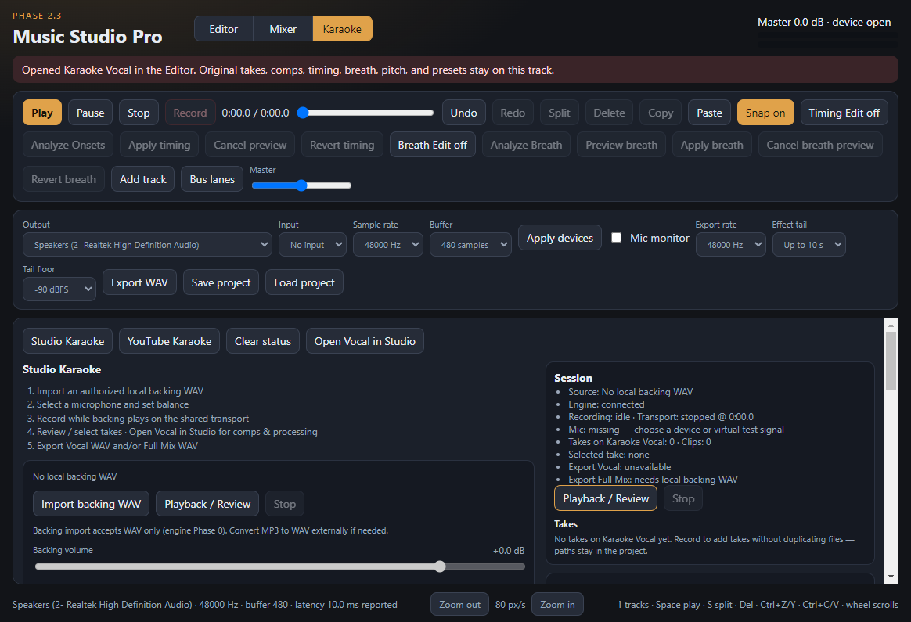
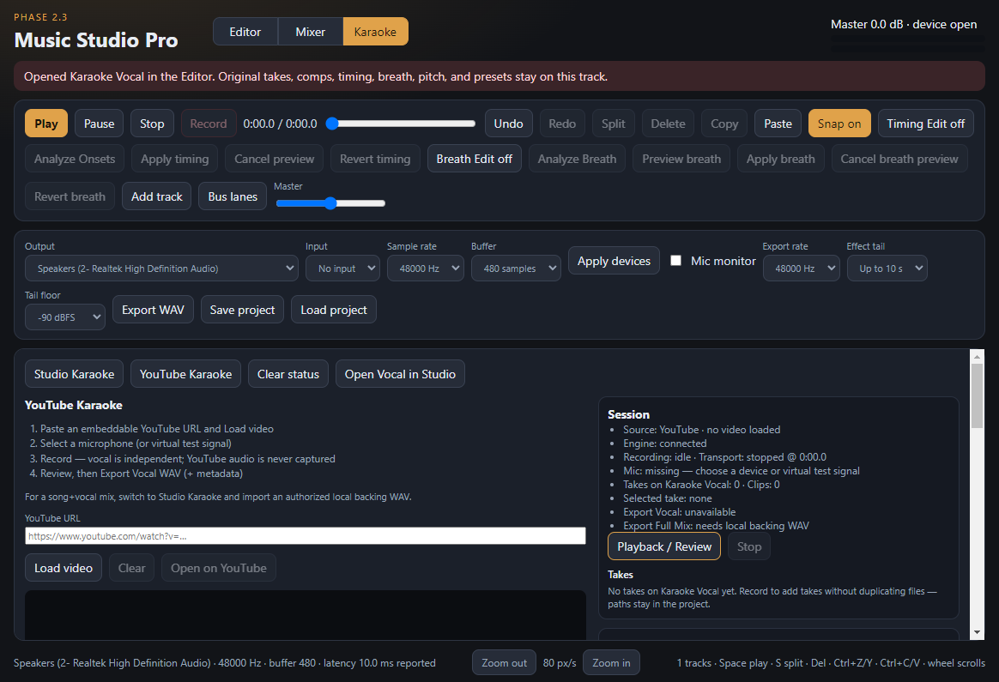

# Karaoke K3 — Workflow & User Experience

**Status:** complete — STOP (do not begin packaging or another phase)  
**Baseline:** Karaoke K1, K1.1, and K2 APPROVED

## 1. Verdict

Karaoke now presents two clear modes — **YouTube Karaoke** and **Studio Karaoke** — with a shared Session panel (source, recording status, takes, export readiness), explicit export options, sync/latency messaging, and **Open Vocal in Studio** that jumps to the existing Editor on the Karaoke Vocal track. No audio engine rewrite; no YouTube audio capture.

## 2. Workflow architecture

```
Karaoke tab
 ├─ Mode: YouTube Karaoke  → URL → embed → mic → record vocal → Export Vocal WAV
 └─ Mode: Studio Karaoke   → import WAV backing → mic → record-with-playback
                              → select takes → balance → Open Vocal in Studio
                              → Export Vocal WAV / Export Full Mix WAV
```

| Concern | Source of truth |
| --- | --- |
| Audio / takes / clips / gains | Engine project (`Karaoke Vocal`, `Karaoke Backing`) |
| Mode, URL, offset prefs | `localStorage` key `msp.karaoke.session.v1` (no audio duplication) |
| Vocal export metadata | `.karaoke.json` sidecar (unchanged from K1) |
| Comp / timing / breath / pitch / presets | Existing Editor + Vocal Workflow (Phase 2.6) |

## 3. Files changed

**Renderer**

- `apps/desktop/renderer/src/KaraokePanel.tsx` — K3 session UI, steps, takes list, sync panel, export panel, prefs, Open Vocal hook
- `apps/desktop/renderer/src/App.tsx` — `openKaraokeVocalInStudio` (fresh `getState`), `data-view="editor"`, Karaoke prop
- `apps/desktop/renderer/src/styles.css` — session / steps / take list styles

**Electron**

- `apps/desktop/electron/karaokeK3Check.ts` (new) — `MSP_KARAOKE_K3_CHECK`
- `apps/desktop/electron/main.ts` — K3 check hook

**Docs**

- `docs/karaoke-k3-final-report.md` (this file)
- `docs/karaoke-k3-screenshots/`

No native engine changes. No packaging.

## 4. Session and take behavior

- Session panel shows current source (YouTube id or backing clip), engine/mic/recording status, take count, selected take, and export readiness.
- Takes are listed from `TrackState.takes` on **Karaoke Vocal** (engine references — files are not copied for the list).
- Selecting a take updates session state for review/export context.
- Mode/URL/offset prefs persist in localStorage across tab revisits without duplicating WAVs.
- Project compatibility: audio remains in the normal project; Open Vocal expands take lanes on the same track.

## 5. Open Vocal in Studio

1. Fresh `getState` so newly created tracks are visible  
2. `setView('editor')`  
3. Select latest Karaoke Vocal clip when present  
4. `setTakesExpanded`  
5. Vocal workflow stage → `comp` (or `record` if empty)  

Preserves original recordings, comps, timing, breath, pitch, and presets — no second editing engine.

## 6. Export behavior

| Action | Requirement | Notes |
| --- | --- | --- |
| **Export Vocal WAV** | Recorded take path | Copies take + `.karaoke.json`; never YouTube audio |
| **Export Full Mix WAV** | Local backing WAV on Karaoke Backing | Mixer path (volumes/FX); button disabled without backing |

## 7. Error / sync UX

Handled with actionable banners/messages (no crash):

- Missing microphone  
- Engine disconnected  
- YouTube embedding failure (K1.1 path retained)  
- Empty/failed take on stop  
- Missing backing (Full Mix gated)  
- Invalid export state  

Sync panel states:

- Studio: shared transport + manual offset (not measured hardware latency)  
- YouTube: wall-clock only — **not** sample-accurate  
- Reported device output latency when available  

## 8. Screenshots





## 9. Exact tests executed

```
Executed:
- npx tsc -p tsconfig.json --noEmit (apps/desktop): exit 0
- npx tsc -p tsconfig.electron.json --noEmit (apps/desktop): exit 0
- npm run build (apps/desktop): exit 0
- MSP_KARAOKE_K3_CHECK=docs\karaoke-k3-screenshots
  (electron --user-data-dir=…\electron-user-data2):
  16 PASS, 0 FAIL, 1 NOT RUN, exit 0

Not run: full regression, K1/K1.1/K2 re-suites, unrelated GUI checks, native suites, installer/packaging
Native rebuild: NOT RUN (no native code changes)
Microphone: NOT RUN — NO HARDWARE
```

### `MSP_KARAOKE_K3_CHECK` (16 PASS, 1 NOT RUN)

| Scenario | Result |
| --- | --- |
| K3 workflow shell present | PASS |
| Studio mode workflow steps | PASS |
| Full Mix gated without backing | PASS |
| Vocal export gated without take | PASS |
| YouTube mode workflow steps | PASS |
| No YouTube audio capture messaging | PASS |
| session prefs saved (mode/offset refs) | PASS |
| sync/latency UX present | PASS |
| does not claim sample-accurate YouTube sync | PASS |
| missing microphone surfaced | PASS |
| project Karaoke Vocal track available | PASS |
| Open Vocal in Studio navigates to Editor | PASS |
| Open Vocal preserves project track (compatibility) | PASS |
| take session view (empty or list) | PASS |
| export options explicit | PASS |
| no renderer console errors | PASS |
| live microphone | NOT RUN — NO HARDWARE |

## 10. Known limitations

- Backing import remains **WAV-only** (engine Phase 0); convert MP3 externally.
- Session prefs (mode/URL/offset) are localStorage, not project JSON — audio/takes still live in the project.
- YouTube synchronization remains approximate; Full Mix never includes iframe audio.
- Manual offset is not automatic device-latency compensation.

## 11. Stop

Karaoke K3 complete. Waiting for approval before packaging or any further phase.
