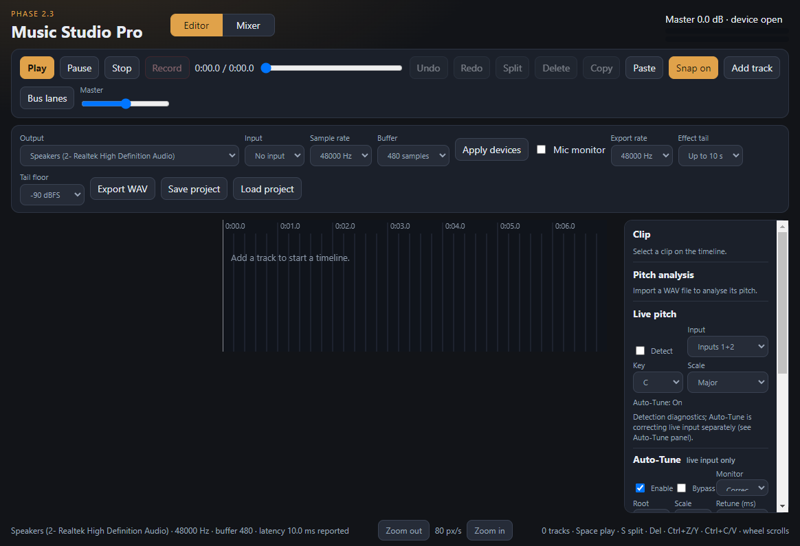

# Phase 2.5.4 — Real-Time Auto-Tune UI & Monitoring Integration: final report

Status: implemented and verified with targeted tests. STOP — awaiting approval before any later phase.

DSP algorithm unchanged (Phase 2.5.3 kernel). This phase adds UI, IPC `monitorMode`, and
latency-aligned RAW track monitoring without altering the recording path.

## 1. Architecture audit (reuse)

| Existing piece | Decision |
| --- | --- |
| Mixer / track inspector | **Reused.** Auto-Tune lives in the inspector after Live pitch, before Recording. |
| `LivePitchPanel` | **Extended.** Shows Auto-Tune On/Off; still detection-only (no audio in React). |
| `getLiveCorrection` / `setLiveCorrection` | **Reused and extended** with `monitorMode` only. |
| `getLivePitch` / `setLivePitch` | **Unchanged.** Live Pitch key/scale remain project mapping. |
| `PitchCorrectionKernel` / live stage | **Unchanged.** One engine instance; no second corrector. |
| Mic Monitor (`micL`/`micR`) | **Unchanged.** Raw device path; undelayed; bypasses the live stage. |
| Recording (`input1`/`input2` post-stage) | **Unchanged policy.** Corrected when Auto-Tune is on. |
| Track input monitoring | **Extended.** Optional `MixInputIO.monitor1/2` so monitoring can hear latency-aligned raw while recording stays corrected. |

## 2. UI implementation

### Auto-Tune panel (`LiveAutoTunePanel`)

Compact inspector section (live input only — not clip playback):

- Enable / Bypass
- Root (C–B), Scale (seven existing scales)
- Retune speed 0–200 ms, Strength 0–100%
- Monitor: Corrected | Raw (aligned)
- Readout: State, DSP latency (ms + samples), sample rate, CPU %, device output samples, end-to-end (Unavailable)
- Errors from rejected IPC shown with `role="alert"`; UI refreshed from `getLiveCorrection` so controls match the engine
- Polls at 5 Hz only while Enable is on

### Live Pitch extensions

- Auto-Tune On/Off in the readout (when Detect is on) and as a badge when Detect is off
- Note, Hz, cents, confidence, target, required fix (existing)
- Hint distinguishes detection vs Auto-Tune correction

### Screenshots

| File | Content |
| --- | --- |
| `docs/phase254-screenshots/live-autotune-01-off.png` | Panel off, defaults, badge Off |
| `docs/phase254-screenshots/live-autotune-02-enabled.png` | Enable on; Live pitch badge On |
| `docs/phase254-screenshots/live-autotune-03-with-live-pitch.png` | Detect on with Auto-Tune status in readout |




## 3. Monitoring routing

```
Live input (device or virtual)
        │
        ├──────────────────────────────► LivePitchDetector (tap, pre-stage)
        │
        ▼
  Live DSP stage (PitchCorrectionKernel)
        │
        ├── post-stage ────────────────► MixInputIO.input1/2 ──► RECORDING (always corrected when on)
        │                                         │
        │                                         └── input FX / processed record buffers
        │
        ├── crossfade(wet=corrected, dry=raw delayed by DSP latency)
        │         │
        │         └──► MixInputIO.monitor1/2 ──► TRACK INPUT MONITORING (monitorMode)
        │
Device input (undelayed) ──────────────► Mic Monitor (always raw; independent)
```

Rules:

- Exactly one intended monitor feed reaches track monitoring (`monitor1` replaces `input` for that path; not both).
- Switching RAW ↔ CORRECTED crossfades over the stage fade length (no hard cut).
- Changing monitor mode does **not** arm track monitoring or Mic monitor.
- Changing monitor mode does **not** change the recording source.
- Peaks for corrected/raw/dry monitor captures matched (~0.354); no ~2× stack.

## 4. Recording behavior (preserved)

| Condition | Recording | Track monitor | Mic monitor |
| --- | --- | --- | --- |
| Auto-Tune off | Dry live input | Dry (same as input) | Raw device |
| Auto-Tune on, monitor corrected | Corrected | Corrected | Raw device |
| Auto-Tune on, monitor raw | Corrected | Latency-aligned raw | Raw device |

- Unsafe rebuild while recording (enable/disable/analysis/input change) remains rejected.
- Key, scale, retune, strength, bypass, **monitor mode** may change while recording.
- No project-schema or recording-format change.
- No delay compensation for recorded takes (same as Phase 2.5.3); UI states this honestly.

## 5. IPC and state

| Op | Change |
| --- | --- |
| `getLiveCorrection` | Adds `monitorMode`, `routing.monitorMode`, `monitoringLatency` (`endToEndMs: null`, DSP vs device out, `trackMonitoring`) |
| `setLiveCorrection` | Accepts `monitorMode: "raw" \| "corrected"`; invalid values refused; no processor rebuild |

Typed in `packages/shared/src/protocol.ts` (`LiveMonitorMode`, `LiveMonitoringLatency`).

## 6. Latency and CPU reporting

| Quantity | Source | UI |
| --- | --- | --- |
| DSP latency | Stage `latencySamples` / ms | Shown when enabled |
| Device output latency | Driver-reported samples (+ ms in IPC) | “Device out” |
| End-to-end monitoring | **Not measured** (no input-device latency) | **Unavailable** |
| CPU | `statistics.averageLoad` | Percent while enabled |

## 7. Files changed

| File | Role |
| --- | --- |
| `native/audio-engine/include/msp/Mixer.h` | Optional `monitor1`/`monitor2` on `MixInputIO` |
| `native/audio-engine/src/Mixer.cpp` | Track monitor uses monitor pointers when set |
| `native/audio-engine/include/msp/Engine.h` | `MonitorMode`, delay ring, crossfade state |
| `native/audio-engine/src/Engine.cpp` | RAW delay + crossfade; IPC monitorMode; monitoringLatency |
| `native/audio-engine/tests/test_main.cpp` | `ipc-rtc-monitor-mode-routing`; defaults cover monitorMode |
| `packages/shared/src/protocol.ts` | Monitor types on `LiveCorrectionStatus` |
| `apps/desktop/renderer/src/LiveAutoTunePanel.tsx` | Auto-Tune controls |
| `apps/desktop/renderer/src/LivePitchPanel.tsx` | Auto-Tune status |
| `apps/desktop/renderer/src/App.tsx` | Panel placement |
| `apps/desktop/renderer/src/styles.css` | Compact Auto-Tune styles |
| `apps/desktop/electron/liveAutoTuneCheck.ts` | `MSP_LIVE_AUTOTUNE_CHECK` |
| `apps/desktop/electron/main.ts` | Env hook |
| `docs/phase254-final-report.md` | This report |
| `docs/phase254-screenshots/*.png` | GUI evidence |

## 8. Exact test commands and results

### Executed

```
scripts\build-engine.ps1
build\audio_engine_tests.exe realtimecorrection
apps\desktop: .\node_modules\.bin\tsc -p tsconfig.json --noEmit
apps\desktop: .\node_modules\.bin\tsc -p tsconfig.electron.json --noEmit
apps\desktop: npm run build
MSP_LIVE_AUTOTUNE_CHECK=D:\MusicStudioPro\build\phase254-live-autotune ; npx electron .
```

| Command | Result |
| --- | --- |
| `scripts\build-engine.ps1` | exit 0 |
| `build\audio_engine_tests.exe realtimecorrection` (final clean run) | **37 PASS, 0 FAIL, 1 NOT RUN**, exit 0 |
| `tsc -p tsconfig.json --noEmit` | exit 0 |
| `tsc -p tsconfig.electron.json --noEmit` | exit 0 |
| `npm run build` | exit 0 |
| `MSP_LIVE_AUTOTUNE_CHECK` | **7 PASS, 0 FAIL, 1 NOT RUN**, exit 0 |

### Native highlight (`ipc-rtc-monitor-mode-routing`)

Takes stay corrected in both modes (−0.00 ¢ from A4). Track monitor corrected −0.00 ¢ vs raw-aligned +46.58 ¢. Peaks identical (0.354); invalid `"both"` refused; mode switch while recording accepted; end-to-end unavailable.

Earlier in the session one `realtimecorrection` run saw a transient `rtc-rt-performance` FAIL (44.1 kHz / 512 spike under load). Assertion unchanged; final re-run **PASS**. Not weakened.

### GUI (`MSP_LIVE_AUTOTUNE_CHECK`)

| Scenario | Result |
| --- | --- |
| Panel layout / defaults / Unavailable end-to-end | PASS |
| Enable → DSP latency + CPU; routing policy | PASS |
| Root / scale / retune / strength → engine | PASS |
| Monitor raw/corrected without silent monitor enable | PASS |
| IPC rejection while recording restores UI | PASS |
| Live pitch Auto-Tune On | PASS |
| Recording produces takes under both monitor modes | PASS |
| Live microphone | **NOT RUN — NO HARDWARE** |

### Not run

- Full regression / `scripts\run-regression.ps1`
- Unrelated native groups
- Unrelated GUI checks
- Installer / packaging
- Microphone: **NOT RUN — NO HARDWARE**

## 9. Known limitations

- Correction applies to **live input only**; clip playback and offline export are not Auto-Tuned.
- End-to-end monitoring latency is **Unavailable** (input device latency not measured).
- Recorded takes have DSP latency with **no compensation**.
- Mic monitor + track monitor both on can still stack (warning from `getLiveCorrection`).
- Live Pitch key/scale are separate from Auto-Tune root/scale (project mapping vs correction params).
- Formant preservation not implemented (unchanged from 2.5.3).

## 10. Stop

Phase 2.5.4 complete. Waiting for approval before continuing.
