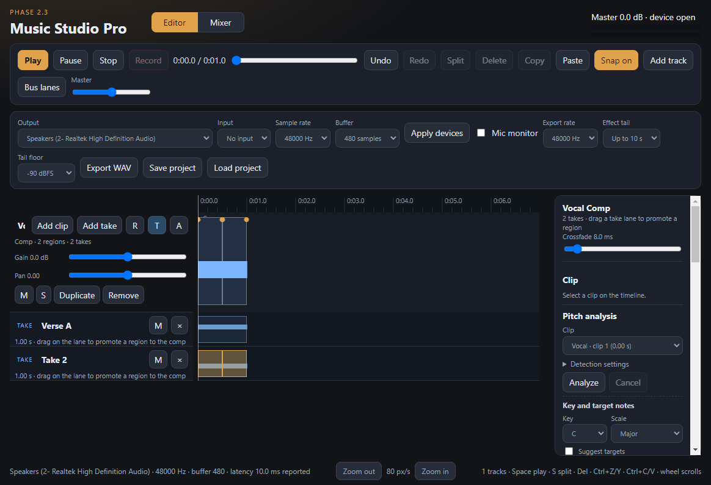
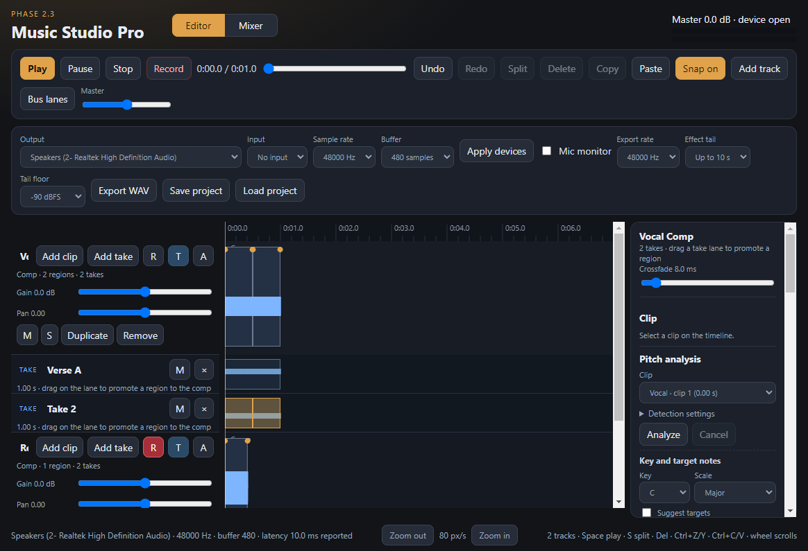

# Phase 2.6.1 — Vocal Comping (Multi-Take Recording & Editing)

**Status:** complete — awaiting approval before Phase 2.6.2  
**Baseline:** Phase 2.5.5 APPROVED

## 1. Verdict

Vocal take lanes, non-destructive region promotion into the existing clip list (the comp), abutting crossfades, undo/redo, project v6 persistence, and timeline UI are in place. Targeted native and GUI checks passed. Source WAVs are never rewritten.

## 2. Architecture

No second timeline engine. Design:

| Layer | Role |
| --- | --- |
| **Takes** | Lane metadata + `sourceFileId` (primary or extra WAV). Display / selection only. |
| **Comp** | Existing track `clips` — the only audio that plays and exports. |
| **Crossfade** | Complementary `fadeOut` / `fadeIn` on abutting clips (no overlap → no gain doubling). |
| **Recording** | First take on an empty track seeds the comp + take lane; later takes add lanes only. |

Core helpers live in `msp/VocalComp.h` (`cutCompHole`, `setCompRegion`). Session APIs wrap them with undo and source loading. Playback/export unchanged: they still render the clip list through the existing arrangement path.

## 3. Files changed

**Native**

- `native/audio-engine/include/msp/VocalComp.h` (new)
- `native/audio-engine/src/VocalComp.cpp` (new)
- `native/audio-engine/include/msp/Project.h` — project version **6**, `ProjectTake`, track take fields
- `native/audio-engine/src/Project.cpp` — serialize / deserialize takes
- `native/audio-engine/include/msp/Session.h` / `src/Session.cpp` — take APIs, undo history, `toProject`
- `native/audio-engine/src/Engine.cpp` — IPC ops, `getState`, multi-take `finishRecording`, load restore
- `native/audio-engine/CMakeLists.txt` — `VocalComp.cpp`
- `native/audio-engine/tests/test_main.cpp` — group `vocalcomp`

**Shared / desktop**

- `packages/shared/src/protocol.ts` — `TakeState`, track take fields, `takeId` on record files
- `apps/desktop/renderer/src/App.tsx` — expandable take lanes, region drag, Vocal Comp inspector
- `apps/desktop/renderer/src/styles.css` — take lane / Takes button styles
- `apps/desktop/electron/vocalCompCheck.ts` (new) — `MSP_VOCAL_COMP_CHECK`
- `apps/desktop/electron/main.ts` — GUI check hook

**Docs**

- `docs/phase261-final-report.md` (this file)
- `docs/phase261-screenshots/` — GUI captures

## 4. Project schema (v6)

`kCurrentProjectVersion = 6`. Backward compatible:

- Versions 1–5 load unchanged (`takes` empty).
- v6 tracks may include optional `takes[]`, `takesExpanded`, `compCrossfadeMs` (default 5 ms, max 100 ms).
- Take fields: `id`, `name`, `sourceFileId`, `timelineStart`, `duration` (session-rate samples), `muted`.
- Comp regions remain the existing `clips` array (non-destructive source offsets).

Saving always writes version 6.

## 5. Take alignment

Each take stores `timelineStart` + `duration` in session-rate samples. Recording and `importTake` use the playhead / requested start. Region selection requires the range to lie inside the take. Snap uses the existing timeline snap helper.

## 6. Comp playback and export

Only track clips contribute to mix/export. Inactive take lanes never play (no double-play). Track effects, routing, master, and offline export are unchanged. Source audio is never flattened automatically.

## 7. Crossfade

Default **5 ms** (`kDefaultCompCrossfadeMs`), configurable 0–100 ms per track. On abutting joins, equal complementary fades are applied; length is clamped to half of each clip so short regions cannot overshoot. Source WAVs are untouched.

## 8. Undo / redo and persistence

`ClipHistory` now snapshots takes, expand state, and crossfade samples with clips. Covered: add/remove take, rename, mute, expand, crossfade, `setCompRegion`, import take. Save/load restores take identities, ordering, selections (as clips), crossfade, and lane visibility.

## 9. UI

Integrated into the existing timeline:

- Comp lane = main track lane (labeled when takes exist)
- **T** expands/collapses take lanes; **Add take** imports a WAV as a lane
- Drag on a take lane promotes a region to the comp (snapped)
- Active regions highlighted on take lanes; Vocal Comp inspector for crossfade

## 10. Screenshots





## 11. Exact test commands and results

```
Executed:
- powershell -ExecutionPolicy Bypass -File scripts\build-engine.ps1: exit 0
- D:\MusicStudioPro\build\audio_engine_tests.exe vocalcomp: 36 PASS, 0 FAIL
- npx tsc -p tsconfig.electron.json --noEmit (apps/desktop): exit 0
- npx tsc -p tsconfig.json --noEmit (apps/desktop): exit 0
- npm run build (apps/desktop): exit 0
- MSP_VOCAL_COMP_CHECK=<temp>: 14 PASS, 0 FAIL, 1 NOT RUN, exit 0

Not run: full regression, unrelated native groups, unrelated GUI checks, installer/packaging
Microphone: NOT RUN — NO HARDWARE
```

### Native `vocalcomp` (36 PASS)

Multiple takes, alignment, region select/replace, abutting crossfade, no duplicate playback, rename/mute/expand, undo/redo, source WAV protection, save/load v6, legacy v5 load, short-region fade clamp, export, IPC import/comp/undo/save/export, virtual record first seeds comp / second lane only.

### GUI `MSP_VOCAL_COMP_CHECK` (14 PASS, 1 NOT RUN)

Takes without auto-place, alignment, region select/replace, crossfades, rename/crossfade, undo/redo, save/load, export, WAV protection, take lanes + inspector UI, successive virtual recordings. Microphone NOT RUN.

## 12. Known limitations

- Take **mute** dims the lane only; it does not solo-audition that take through the mix (comp remains the playback path).
- Punch-in / loop recording were not added (not previously supported).
- Comp joins use abutting complementary fades, not overlapping equal-power crossfades.
- Expanding takes is per-track UI state persisted in the project; no separate take editor window.
- Phase 2.6.2 timing alignment, AI take selection, formant work, VST3, and packaging are out of scope.

## 13. Stop

Phase 2.6.1 is complete. Waiting for approval before any further phase work.
