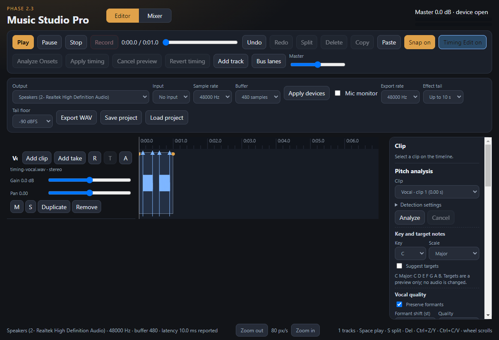

# Phase 2.6.2 — Vocal Timing Alignment

**Status:** complete — awaiting approval before any further phase  
**Baseline:** Phase 2.6.1 Vocal Comping APPROVED (project schema v6)

## 1. Verdict

Non-destructive vocal timing alignment is in place on the existing multitrack timeline: offline onset suggestions, manual markers, beat/grid snap in the UI, bounded pitch-preserving local time-stretch (0.75×–1.25×), undo/redo, save/load, and playback/export via derived caches. Timing edits attach to **comp clips** only. Source WAVs are never rewritten. Targeted native and GUI checks passed.

## 2. Architecture

No second timeline or realtime stretch path. Design:

| Layer | Role |
| --- | --- |
| **Onset analysis** | Offline short-time energy + spectral flux → suggested markers on a clip |
| **Timing markers** | Sample-accurate positions on the clip’s current source; detected = suggestions, manual = user |
| **Preview** | Renderer-only pending marker position until Apply |
| **Apply** | Offline `timeWarpSegments` (phase vocoder) writes a derived extra WAV; clip points at it |
| **Comp / takes** | Comp clips remain the only playback/export path; take lanes unchanged |
| **Revert** | Restores `timingOriginal*` provenance to the pre-warp source |

**Ownership:** timing markers and applied warps live on **comp clips**, not takes. Never silently modify all takes.

### Pre-change limitations (audit)

- Pitch path already had offline stretch (`Stretcher` / phase vocoder); timing UI and local elastic warp were missing.
- Snap/grid lived in the renderer (`placeTime`); native stored absolute sample times only.
- Comp clips = playback; takes = metadata — preserved.

### Reused components

- Existing clip / extra-source model and arrangement playback
- Existing `Stretcher` phase vocoder (`PitchShift.cpp`) via new `timeStretch` / `timeWarpSegments`
- Existing undo stacks, project extras, beat/grid snap helper, fade fields

## 3. Files changed

**Native**

- `native/audio-engine/include/msp/OnsetDetection.h` / `src/OnsetDetection.cpp` (new)
- `native/audio-engine/include/msp/Timing.h` / `src/Timing.cpp` (new)
- `native/audio-engine/include/msp/TimeStretch.h` (new API surface)
- `native/audio-engine/src/PitchShift.cpp` — `timeStretch` / `timeWarpSegments`
- `native/audio-engine/include/msp/Timeline.h`, `Project.h` — clip timing fields
- `native/audio-engine/src/Project.cpp` — serialize/deserialize optional timing fields (still v6)
- `native/audio-engine/include/msp/Session.h` / `src/Session.cpp` — analyze/add/remove/move/apply/revert
- `native/audio-engine/src/Engine.cpp` — IPC + `getState`
- `native/audio-engine/CMakeLists.txt`
- `native/audio-engine/tests/test_main.cpp` — group `vocaltiming`

**Shared / desktop**

- `packages/shared/src/protocol.ts` — `TimingMarker`, clip timing fields
- `apps/desktop/renderer/src/App.tsx` — Timing Edit mode, markers, preview/apply/revert
- `apps/desktop/renderer/src/styles.css` — timing mode button
- `apps/desktop/electron/vocalTimingCheck.ts` (new) — `MSP_VOCAL_TIMING_CHECK`
- `apps/desktop/electron/main.ts` — GUI check hook

**Docs**

- `docs/phase262-final-report.md` (this file)
- `docs/phase262-screenshots/` — GUI captures

## 4. Onset detection method

Offline only (never in the audio callback):

1. Hann-windowed STFT (512 @ ≤60 kHz, 1024 above; hop = N/4)
2. Per-frame energy and positive spectral flux
3. Adaptive threshold from median/mean flux and sensitivity
4. Local maxima with energy-rise / high-flux preference (silence→voice, attacks)
5. Minimum separation merge (default 40 ms); non-finite samples repaired/ignored
6. Mono or stereo WAV; rates validated 8–192 kHz (product focus 44.1 / 48 kHz)

**Not** phoneme-accurate. Markers are suggestions; the user remains in control.

## 5. Time-stretch method

Pitch-preserving offline phase vocoder (`timeStretch` / `timeWarpSegments`), not resampling.

| Item | Value |
| --- | --- |
| Supported ratio | **0.75× – 1.25×** (`kTimeStretchMinRatio` / `kTimeStretchMaxRatio`) |
| Segment joins | Short crossfades |
| Channels | Mono or stereo; channels stretched together |
| Clip length | Elastic warp keeps clip timeline duration; invalid ratios rejected |
| Realtime | Not used in the audio callback |

### Pitch preservation measurement (native)

`vocaltiming-pitch-preservation`: 220 Hz tone stretched 1.1× → measured **in=220 Hz, out=220 Hz** (PASS; tolerances ≤8 Hz in / ≤12 Hz out).

## 6. Timing edit model

Per-comp-clip fields:

- `timingMarkers[]` — `{ id, sourceSample, manual }`
- On apply: `timingOriginalSourceFileId` / `Offset` / `Duration`, `timingLabel`, new derived `sourceFileId` (extra WAV under temp cache, rebuildable)
- Markers remapped into the new source (offset 0)

Validation: chronological sort, clamp to clip bounds, stretch-ratio bounds, no zero/negative segment lengths, source WAV SHA unchanged.

## 7. Comp integration

- Take lanes intact; only the intended **comp clip** is warped
- No double playback (takes never feed the mix)
- Existing abutting crossfades remain clip fade fields
- Replacing a comp region after timing: new clip starts without prior timing provenance unless markers are re-analyzed

## 8. Playback and export

Processed extras participate in the same arrangement path as other clip sources. Preview uses applied audio after Apply; Cancel preview drops UI-only pending moves. Offline export matches playback. Track effects still apply. No duplicate audio paths; no pitch shift from the stretch path.

## 9. Undo / redo and persistence

History covers analyze (marker replace), add/remove/move marker, apply, revert. Undo restores prior audible sources, not only UI markers.

**Schema:** remains **project version 6**. Timing fields are optional additive clip properties. Projects v1–v6 load; missing timing fields = empty markers / no warp. Derived caches with missing paths are not source overwrites; apply writes a temp WAV so save can persist extras. Source WAVs are never overwritten.

## 10. UI / UX

Integrated into the existing timeline (no new window):

- **Timing Edit** mode — disables accidental whole-clip drag
- **Analyze Onsets**, marker drag with optional **Snap**, double-click to add
- **Apply timing** / **Cancel preview** / **Revert timing**
- Clear pressed state on the Timing Edit control

## 11. Screenshots




## 12. Exact test commands and results

```
Executed:
- powershell -ExecutionPolicy Bypass -File scripts\build-engine.ps1: exit 0
- D:\MusicStudioPro\build\audio_engine_tests.exe vocaltiming: 33 PASS, 0 FAIL
- npx tsc -p tsconfig.json --noEmit (apps/desktop): exit 0
- npx tsc -p tsconfig.electron.json --noEmit (apps/desktop): exit 0
- npm run build (apps/desktop): exit 0
- MSP_VOCAL_TIMING_CHECK=docs\phase262-screenshots: 11 PASS, 0 FAIL, 1 NOT RUN, exit 0

Not run: full regression, scripts\run-regression.ps1, unrelated native groups,
         unrelated GUI checks, installer/packaging
Microphone: NOT RUN — NO HARDWARE
```

### Native `vocaltiming` (33 PASS)

Onset detection/separation, stretch ratio validation, stereo integrity, pitch preservation, import/analyze, marker ordering/boundaries/add/move, apply + provenance, playback after apply, export + export-match, undo/redo/revert, comp interaction, source WAV protection, save/load markers, crossfade identity, IPC analyze/add/move/apply/undo/save/source-protected.

### GUI `MSP_VOCAL_TIMING_CHECK` (11 PASS, 1 NOT RUN)

Timing Edit toggle, Analyze Onsets, marker add/move, Apply (or bounded reject), clip start unchanged, Revert, save/reopen, source WAV protection, controls present. Microphone NOT RUN.

## 13. Known limitations

- Onsets are energy/flux suggestions, not phonemes or AI alignment.
- Stretch is capped at 0.75×–1.25×; larger moves are rejected with a clear error.
- Applied caches are written under the system temp directory; missing caches need re-Apply (source WAV remains intact).
- Timing Edit mode is clip-scoped; multi-clip batch alignment is out of scope.
- No realtime time-stretch, AI enhancement, new pitch correction, VST3, or packaging (explicitly out of scope).

## 14. Stop

Phase 2.6.2 complete. Waiting for approval before any further work.
