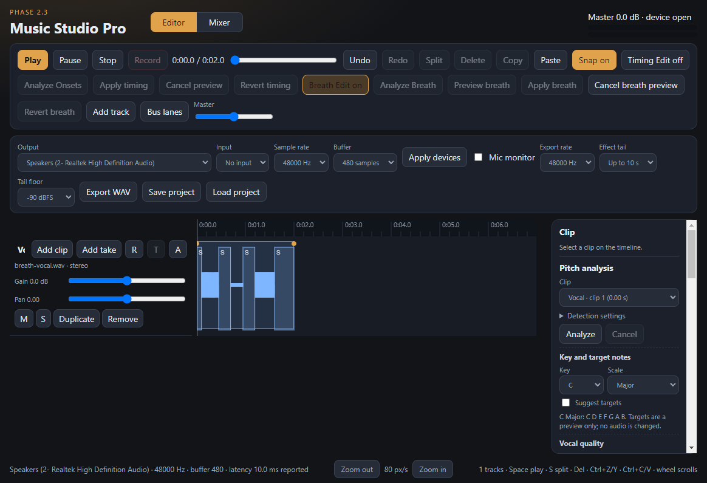

# Phase 2.6.3 — Breath & Silence Editing

**Status:** complete — awaiting approval before any further phase  
**Baseline:** Phase 2.6.1 Vocal Comping APPROVED · Phase 2.6.2 Vocal Timing Alignment APPROVED (project schema v6)

## 1. Verdict

Non-destructive breath/silence region editing is in place on comp clips: offline silence detection, conservative breath-candidate heuristics, region CRUD with gain/fades/ignore, Preview / Apply / Revert via derived extras, undo/redo, and additive v6 persistence. Timing apply explicitly invalidates breath edits. Source WAVs are never rewritten. Targeted native and GUI checks passed.

## 2. Architecture / processing order

| Stage | Role |
| --- | --- |
| 1. Source WAV | Immutable |
| 2. Timing alignment (2.6.2) | Optional derived extra |
| 3. Breath/silence gains (2.6.3) | Offline bake into derived extra on Apply / Preview |
| 4. Clip gain + fades | Arrangement render |
| 5. Track effects → mix/export | Existing path |

No second audio engine; no realtime breath DSP in the audio callback. Preview uses the same bake as Apply into a `preview=true` extra (arrangement override). Timing edits clear breath regions/provenance (reanalysis required).

**Ownership:** regions attach to **comp clips** only; take lanes untouched.

### Pre-change limitations (audit)

- Clip gain/fades existed; no region-scoped gain envelopes.
- Timing derived extras provided the pattern for non-destructive bake + provenance.
- Snap/grid and waveform rendering reused for region UI.

## 3. Files changed

**Native**

- `native/audio-engine/include/msp/BreathSilence.h` / `src/BreathSilence.cpp` (new)
- `native/audio-engine/include/msp/Timeline.h`, `Project.h` — clip breath fields
- `native/audio-engine/src/Project.cpp` — serialize/deserialize (still v6)
- `native/audio-engine/include/msp/Session.h` / `src/Session.cpp` — analyze/CRUD/preview/apply/revert; timing invalidation
- `native/audio-engine/src/Engine.cpp` — IPC + `getState`
- `native/audio-engine/CMakeLists.txt`
- `native/audio-engine/tests/test_main.cpp` — group `vocalbreath`

**Shared / desktop**

- `packages/shared/src/protocol.ts` — `BreathRegion`, clip breath fields
- `apps/desktop/renderer/src/App.tsx` — Breath Edit mode, regions, inspector
- `apps/desktop/renderer/src/styles.css`
- `apps/desktop/electron/vocalBreathCheck.ts` (new) — `MSP_VOCAL_BREATH_CHECK`
- `apps/desktop/electron/main.ts` — GUI check hook

**Docs**

- `docs/phase263-final-report.md` (this file)
- `docs/phase263-screenshots/` — GUI captures

## 4. Detection algorithms

**Silence:** short-time RMS, adaptive ~10th-percentile noise floor + margin (or fixed threshold), enter/exit hysteresis, minimum duration, gap merge. Mono/stereo; rejects non-finite samples.

**Breath candidates (heuristic only):** spectral flatness, high-frequency energy ratio, mid-level RMS envelope, proximity to silence edges; confidence score; distinct from silence. **Not** reliable breath recognition.

### Synthetic fixture FP/FN (not real-world accuracy)

Unit-test fixture: tone · silence · quiet noise · tone · distant quiet noise.

| Metric | Result |
| --- | --- |
| True positive (near-phrase noise) | 1 |
| False negative | 0 |
| False positive (reported) | 0 |

Do not treat this as production accuracy without representative vocal recordings.

## 5. Region gain / fades

| Item | Value |
| --- | --- |
| Gain range | **−60 … +12 dB** |
| Default breath proposal | **−6 dB** |
| Default silence proposal | **−40 dB** |
| Fades | Raised-cosine; user fades + minimum ~3 ms on bake |

Overlapping non-ignored regions are rejected. Detected regions carry proposed gains but do not change audio until Preview/Apply.

## 6. Comp & timing integration

- Edits only intended comp clips; takes never play.
- Comp replacement yields new clips without stale breath data.
- Timing apply/revert clears breath regions/provenance (explicit invalidation preferred over remapping).

## 7. Playback and export

Applied extras use the same arrangement path as other clip sources. Preview matches Apply bake semantics for audible result. Offline export matches playback after Apply. Track effects still apply. No pitch change from this path; no double gain; source WAVs untouched.

## 8. Undo / redo and persistence

History covers analyze, add/remove/set/ignore, apply, revert. Undo restores prior audible sources.

**Schema:** remains **project version 6**. Additive optional clip fields: `breathRegions[]`, `breathOriginalSourceFileId` / `Offset` / `Duration`, `breathLabel`. Projects v1–v6 load; missing fields = empty. Derived caches under temp; never overwrite sources.

## 9. UI / UX

Integrated into the existing timeline:

- **Breath Edit** mode (mutually exclusive with Timing Edit for clip-drag safety)
- **Analyze Breath**, region highlights by kind (silence / breath / manual)
- Select, boundary drag, double-click add
- Inspector: gain, fades, ignore/unignore, delete
- **Preview / Apply / Cancel preview / Revert**

## 10. Screenshots




## 11. Exact test commands and results

```
Executed:
- Verified MusicStudioEngine not running; MusicStudioEngine.exe unlocked
- powershell -ExecutionPolicy Bypass -File scripts\build-engine.ps1: exit 0
- D:\MusicStudioPro\build\audio_engine_tests.exe vocalbreath: 39 PASS, 0 FAIL
- npx tsc -p tsconfig.json --noEmit (apps/desktop): exit 0
- npx tsc -p tsconfig.electron.json --noEmit (apps/desktop): exit 0
- npm run build (apps/desktop): exit 0
- MSP_VOCAL_BREATH_CHECK=docs\phase263-screenshots: 13 PASS, 0 FAIL, 1 NOT RUN, exit 0

Not run: full regression, scripts\run-regression.ps1, unrelated native groups,
         unrelated GUI checks, installer/packaging
Microphone: NOT RUN — NO HARDWARE
```

### Native `vocalbreath` (39 PASS)

Silence detection, adaptive threshold, breath candidates, synthetic TP/FN/FP report, mono, gain/stereo/fade continuity, gain range, import/analyze, boundaries, ignore, manual add, preview/apply/playback/export match, comp isolation, timing invalidation, undo/redo/revert, save/load v6, source WAV protection, IPC analyze/ignore/add/preview/apply/undo/save/source-protected.

### GUI `MSP_VOCAL_BREATH_CHECK` (13 PASS, 1 NOT RUN)

Breath Edit toggle, Analyze, ignore, manual add, boundary/gain/fade update, Preview/Apply/Revert, clip start unchanged, save/reopen, source WAV protection, controls present. Microphone NOT RUN.

## 12. Known limitations

- Breath detection is candidate-only; expect false positives/negatives on real vocals.
- Proposed gains on candidates do not mute until Apply.
- Timing remaps invalidate breath edits (by design).
- Applied caches live under the system temp directory.
- No AI separation, noise suppression, realtime formant work, VST3, or packaging (out of scope).

## 13. Stop

Phase 2.6.3 complete. Waiting for approval before any further work.
