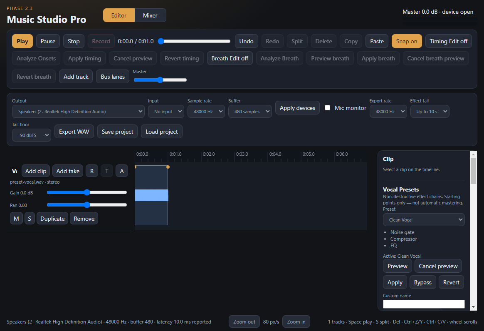

# Phase 2.6.4 — Vocal Processing Presets

**Status:** complete — awaiting approval before any further phase  
**Baseline:** Phase 2.6.3 Breath & Silence Editing APPROVED (project schema v6)

## 1. Verdict

Non-destructive vocal processing presets are implemented on top of the existing track insert effect chain (EQ, compressor, gate, reverb, delay). Six immutable factory presets ship in code; custom presets persist in the project; Preview / Apply / Bypass / Revert / Save / Rename / Delete / Restore factory are wired through Session IPC and an Inspector panel. Source WAVs, comps, timing, breath, pitch, and routing are untouched. Targeted native and GUI checks passed.

## 2. Preset architecture

| Piece | Behavior |
| --- | --- |
| Factory presets | Code-only in `VocalPresets.cpp`; never written to disk; delete/rename refused |
| Custom presets | Project field `customVocalPresets[]`; validated on load; factory-id collisions skipped |
| Apply | Replaces the track insert chain with freshly instantiated effect IDs (no stacking) |
| Previous chain | First Apply stores prior inserts in `vocalPresetPrevious` for Revert |
| Preview | Temporary chain + restore via `cancelVocalPresetPreview` / end-preview |
| Bypass | Sets `vocalPresetBypassed` and toggles `enabled` on current inserts |
| Undo / redo | Dedicated `effectUndoStack` / `effectRedoStack`; hooked when clip undo is empty |
| DSP | Unchanged — presets only set existing effect parameters |

**Processing order (unchanged):** source → timing → breath bake → clip gain/fades → **track effects (presets)** → mix/export.

## 3. Files changed

**Native**

- `native/audio-engine/include/msp/VocalPresets.h` / `src/VocalPresets.cpp` (new)
- `native/audio-engine/include/msp/Project.h` — track `vocalPreset*` + `customVocalPresets`
- `native/audio-engine/src/Project.cpp` — additive v6 serialize/load + validation
- `native/audio-engine/include/msp/Session.h` / `src/Session.cpp` — preview/apply/bypass/revert/custom CRUD/restore; effect history
- `native/audio-engine/src/Engine.cpp` — IPC + `getState.vocalPresets`
- `native/audio-engine/CMakeLists.txt`
- `native/audio-engine/tests/test_main.cpp` — group `vocalpresets`

**Shared / desktop**

- `packages/shared/src/protocol.ts` — track preset fields, `VocalPresetSummary`, `EngineState.vocalPresets`
- `apps/desktop/renderer/src/VocalPresetsPanel.tsx` (new)
- `apps/desktop/renderer/src/App.tsx` — Inspector wiring
- `apps/desktop/renderer/src/styles.css` — panel styles
- `apps/desktop/electron/vocalPresetCheck.ts` (new) — `MSP_VOCAL_PRESET_CHECK`
- `apps/desktop/electron/main.ts` — GUI check hook

**Docs**

- `docs/phase264-final-report.md` (this file)
- `docs/phase264-screenshots/` — GUI captures

## 4. Factory preset parameters

Conservative starting points only — not automatic mastering.

### Clean Vocal (`factory-clean-vocal`)
- Gate: threshold −48 dB, attack 1 ms, hold 30 ms, release 120 ms, range −48 dB
- Compressor: threshold −20 dB, ratio 2.5, attack 12 ms, release 140 ms, makeup +2 dB
- EQ: HPF ~90 Hz (−2 dB), cut ~250 Hz (−1 dB), presence ~3.2 kHz (+1.5 dB), air ~10 kHz (+1 dB)

### Warm Vocal (`factory-warm-vocal`)
- EQ: low shelf ~120 Hz (+2 dB), body ~350 Hz (+1 dB), mild cut ~2.5 kHz (−1 dB), air soft ~9 kHz (−2 dB)
- Compressor: threshold −18 dB, ratio 3, attack 18 ms, release 180 ms, makeup +1.5 dB

### Bright Vocal (`factory-bright-vocal`)
- EQ: HPF ~100 Hz (−1.5 dB), presence ~4.5 kHz (+2.5 dB), air ~11 kHz (+2 dB)
- Compressor: threshold −22 dB, ratio 2.5, attack 8 ms, release 120 ms, makeup +2 dB

### Soft Ballad (`factory-soft-ballad`)
- Compressor: threshold −24 dB, ratio 2, attack 25 ms, release 220 ms, makeup +1 dB
- EQ: gentle low shelf + soft highs
- Reverb: roomSize 0.35, damping 0.55, mix 0.18

### Podcast Voice (`factory-podcast-voice`)
- Gate: threshold −42 dB, tighter range (−60 dB)
- EQ: rumble cut, mild mud cut, speech presence ~2.5 kHz, soft high shelf
- Compressor: threshold −16 dB, ratio 4, attack 6 ms, release 90 ms, makeup +3 dB

### Vocal Reverb (`factory-vocal-reverb`)
- EQ: light cleanup
- Compressor: moderate leveling
- Reverb: roomSize 0.55, damping 0.4, mix 0.28

## 5. Persistence

**Schema remains project version 6** (additive; no migration).

| Field | Location |
| --- | --- |
| `vocalPresetId` | per track |
| `vocalPresetBypassed` | per track |
| `vocalPresetPrevious` | per track (prior insert chain for Revert) |
| `customVocalPresets[]` | project root |

Load skips malformed customs and factory-id collisions with warnings. Missing fields = empty / inactive. Factory presets are never persisted.

## 6. UI

Inspector **Vocal Presets** section:

- Preset selector + effect-chain preview list
- Preview / Cancel preview / Apply / Bypass / Revert
- Save Custom Preset, Delete custom, Restore factory
- Unsaved-selection hint when selector ≠ active preset
- Falls back to first track when no clip selection

## 7. Screenshots




## 8. Exact test commands and results

```
Executed:
- Verified MusicStudioEngine not running; MusicStudioEngine.exe unlocked
- powershell -ExecutionPolicy Bypass -File scripts\build-engine.ps1: exit 0
- D:\MusicStudioPro\build\audio_engine_tests.exe vocalpresets: 29 PASS, 0 FAIL
- npx tsc -p tsconfig.json --noEmit (apps/desktop): exit 0
- npx tsc -p tsconfig.electron.json --noEmit (apps/desktop): exit 0
- npm run build (apps/desktop): exit 0
- MSP_VOCAL_PRESET_CHECK=docs\phase264-screenshots: 12 PASS, 0 FAIL, 1 NOT RUN, exit 0

Not run: full regression, scripts\run-regression.ps1, unrelated native groups,
         unrelated GUI checks, installer/packaging
Microphone: NOT RUN — NO HARDWARE
```

### Native `vocalpresets` (29 PASS)

Factory count/validation, find Clean, invalid empty effects, apply, repeated apply no duplication, preserves comp/timing/breath, preview + cleanup, bypass/unbypass, undo/redo, revert, save custom, factory immutable delete/rename, save/load, invalid id, source WAV protected, IPC import/apply/no-dupe/bypass/undo-redo/save-custom/save-load/source-protected.

### GUI `MSP_VOCAL_PRESET_CHECK` (12 PASS, 1 NOT RUN)

Clip import, 6 factories, Apply, repeated Apply, Bypass, Revert, Save custom, factory delete refused, save/reopen, source WAV protected, UI panel/select/apply present, UI Apply clickable. Microphone NOT RUN.

## 9. Known limitations

- Presets replace the track insert chain on Apply (previous chain kept for Revert); they do not merge with unrelated inserts unless the user Reverts first.
- Preview is temporary; leaving preview without Cancel/Apply restores via end-preview semantics.
- Factory presets cannot be edited in place — save a custom copy instead.
- No VST3 / third-party inserts in presets.
- Parameter values are conservative starting points, not genre- or singer-specific mastering.
- Rename custom is available via Session/IPC; Inspector focuses on Save / Delete / Restore factory.

## 10. Stop

Phase 2.6.4 complete. Waiting for approval before Phase 2.6.5 or YouTube Karaoke.
