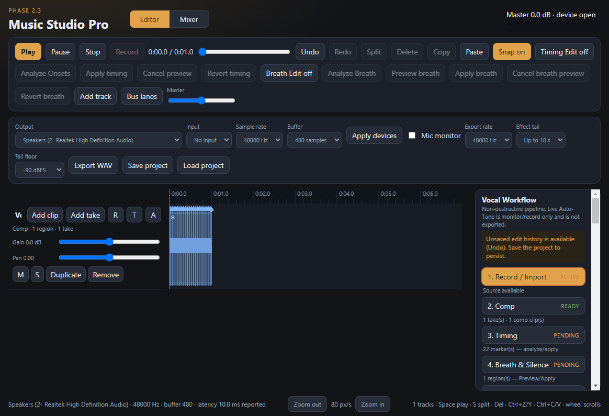
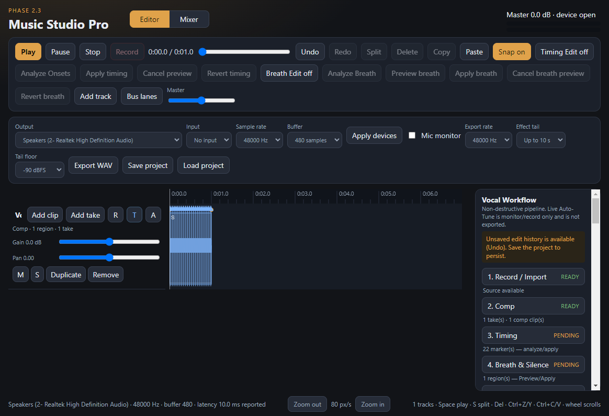

# Phase 2.6.5 — Vocal Workflow Integration

**Status:** complete — awaiting approval before any further phase  
**Baseline:** Phases 2.6.1–2.6.4 APPROVED (project schema v6)

## 1. Verdict

Vocal production stages (record/import → comp → timing → breath → offline pitch → presets → mix/export) are integrated into one non-destructive workflow. Cross-stage invalidation now clears or refuses stale downstream processing; temporary previews end before export so committed playback matches the export mix; `getState.vocalWorkflow` exposes pipeline status; and a Vocal Workflow inspector section guides stage status without duplicating editors. Schema remains v6. Targeted native and GUI checks passed.

## 2. Workflow architecture / actual processing order

| Stage | Role |
| --- | --- |
| 1. Source WAV / takes | Immutable originals |
| 2. Comp | Take lanes → active **comp clips** |
| 3. Timing (optional) | Markers → offline warp extra |
| 4. Breath & silence (optional) | Regions → baked gain extra on Apply |
| 5. Offline pitch (optional) | Analyze / process / apply → derived extra |
| 6. Clip gain + fades | Arrangement |
| 7. Track FX / vocal presets | Insert chain on the track |
| 8. Buses / master / export | Existing mix path |

**Parallel (not in the clip chain):** Live Auto-Tune / Live Pitch = **monitor and record only**. Clip playback and WAV export never run live correction.

**Previews:** Pitch, breath, and preset previews temporarily override arrangement or the insert chain. Export ends all previews first so the file matches committed state.

## 3. Integration issues discovered and fixed

| Issue | Fix |
| --- | --- |
| Timing remap cleared breath but left offline pitch provenance | Timing apply / marker warp also clears pitch provenance + note targets |
| Breath apply left pitch provenance against the wrong source | Breath apply clears pitch provenance |
| Revert breath/timing while pitch was stacked on top | Refuse with an explicit message until pitch is reverted |
| `exportWav` kept pitch preview → export ≠ what you hear | Remove `exportWav` from keep-list; end pitch, breath, and preset previews before export |
| No unified workflow status in UI/state | `getState.vocalWorkflow` + Vocal Workflow inspector panel |
| Preview-active / Live AT-not-in-export not surfaced | Preview flags + documented note in state and UI banner |

Not rewritten: DSP algorithms, mixer, automation, or prior phase editors.

## 4. Files changed

**Native**

- `native/audio-engine/src/Session.cpp` — cross-stage clear/refuse helpers; timing/breath/pitch guards
- `native/audio-engine/src/Engine.cpp` — export ends previews; `vocalWorkflow` in `getState`
- `native/audio-engine/tests/test_main.cpp` — group `vocalworkflow`

**Shared / desktop**

- `packages/shared/src/protocol.ts` — `VocalWorkflowState`
- `apps/desktop/renderer/src/VocalWorkflowPanel.tsx` (new)
- `apps/desktop/renderer/src/App.tsx` — inspector wiring
- `apps/desktop/renderer/src/styles.css`
- `apps/desktop/electron/vocalWorkflowCheck.ts` (new) — `MSP_VOCAL_WORKFLOW_CHECK`
- `apps/desktop/electron/main.ts` — GUI check hook

**Docs**

- `docs/phase265-final-report.md` (this file)
- `docs/phase265-screenshots/` — GUI captures

## 5. State / persistence

**Schema remains project version 6.** No migration. Existing projects load unchanged.

Workflow status is **derived** at runtime (`vocalWorkflow`); it is not persisted. Applied stage data continues to use existing clip/track fields (`timing*`, `breath*`, pitch `originalSource*`, `vocalPreset*`, takes/clips).

Invalidation is explicit (clear or refuse) — stale analysis is never silently reused after an upstream remap.

## 6. Playback / export verification

| Path | Playback | Export |
| --- | --- | --- |
| Comp / applied timing / breath / offline pitch / presets / FX / tails / automation | Yes | Yes (same committed arrangement + mix) |
| Pitch / breath / preset **preview** | Temporary override | Ended before export |
| Live Auto-Tune | Monitor / record | **Never** |

Native check confirmed arranged play buffer length matches exported WAV after committed processing. IPC check confirmed export clears an active preset preview flag.

## 7. UI

Inspector **Vocal Workflow** section:

1. Record / Import  
2. Comp  
3. Timing  
4. Breath & Silence  
5. Pitch Correction  
6. Vocal Presets  
7. Mix & Export  

Shows stage status (`ready` / `active` / `pending` / `blocked` / `preview`), banners for missing source / active preview / unsaved undo history, and stage navigation that enables Timing/Breath edit modes where appropriate. Existing editors remain the place to perform work — this panel does not duplicate them.

## 8. Screenshots





## 9. Exact test commands and results

```
Executed:
- Verified MusicStudioEngine not running; MusicStudioEngine.exe unlocked
- powershell -ExecutionPolicy Bypass -File scripts\build-engine.ps1: exit 0
- D:\MusicStudioPro\build\audio_engine_tests.exe vocalworkflow: 28 PASS, 0 FAIL
- npx tsc -p tsconfig.json --noEmit (apps/desktop): exit 0
- npx tsc -p tsconfig.electron.json --noEmit (apps/desktop): exit 0
- npm run build (apps/desktop): exit 0
- MSP_VOCAL_WORKFLOW_CHECK=docs\phase265-screenshots: 10 PASS, 0 FAIL, 1 NOT RUN

Not run: full regression, scripts\run-regression.ps1, prior-phase native groups
         (vocalcomp/timing/breath/presets), unrelated GUI checks, installer/packaging
Microphone: NOT RUN — NO HARDWARE
```

### Native `vocalworkflow` (28 PASS)

Import, multi-take/comp, timing clears pitch+breath, breath clears pitch, revert breath/timing blocked while pitch applied, pitch revert, preset after stages, playback/export match, undo/redo, save/load v6, invalid preset, source WAV protected; IPC state/previews, preset preview flag, export ends preview, save/load.

### GUI `MSP_VOCAL_WORKFLOW_CHECK` (10 PASS, 1 NOT RUN)

Import, `vocalWorkflow` state, multi-take+comp, preset after analysis, preview flag, export ends preview, save/reopen, source protection, UI panel/stages, stage navigation. Microphone NOT RUN.

## 10. Known limitations

- Live Auto-Tune remains monitor/record only; offline pitch is the exported correction path.
- Comp geometry edits (split/trim/cut remnants) still copy clip metadata without remapping markers/regions — out of scope beyond workflow invalidation on timing/breath/pitch applies.
- Vocal Workflow panel navigates stages; detailed editing still uses existing Timing/Breath/Pitch/Preset controls.
- Preset Apply still replaces the track insert chain (by design from 2.6.4); Revert restores the previous chain.
- Electron GUI-check process required a stop after a successful exit path hang (check results already written).

## 11. Stop

Phase 2.6.5 complete — final development step of Phase 2.6. Waiting for approval before YouTube Karaoke, packaging, or any other phase.
