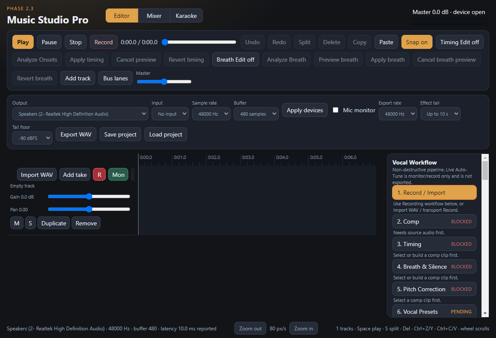

# Phase 2.7.1 — Recording Workflow & Monitoring

**Status:** complete — STOP (await approval before 2.7.2)  
**Baseline:** Phase 2.6 + Karaoke K1–K3 completed

## 1. Verdict

Editor recording UX now has a clear **Recording workflow** panel (status, Start/Stop, Review, Retake, monitoring), transport that blocks invalid Pause/Stop while recording, and preflight that stops playback before record so arrangement clips can back the take. No JUCE rewrite; Karaoke Studio was not duplicated.

## 2. Existing features reused

| Capability | Source |
| --- | --- |
| Record start/stop + take placement | Engine `record` / `finishRecording` |
| Record-with-playback | Engine forces transport `playing` on record start |
| Multi-take / comps | Phase 2.6.1 take lanes |
| Track arm / monitor | `setTrackRecord` |
| RAW/CORRECTED | Live Auto-Tune `setLiveCorrection` `monitorMode` |
| Global Mic monitor | Existing devices-bar `setMonitor` |
| EngineHost disconnect | Existing EPIPE-safe rejection |

## 3. Recording UX improvements

- **Recording workflow panel** (`data-panel="recording-workflow-271"`): engine/input/armed/state/duration/monitor summary from real `EngineState`
- **Start recording**: refuses no-arm / no-mic / device closed; stops transport if playing; notices when recording
- **Stop recording**: surfaces empty-take without destroying earlier takes
- **Review take** / **Retake**: seek + play / seek + record again
- Transport **Pause/Stop disabled while recording** (use Stop rec)
- Record button gated on arm + mic/virtual input
- Lane **Mon** button when armed (input monitor)
- Vocal Workflow stage copy points at the Recording workflow panel

## 4. Monitoring behavior

| Control | Behavior |
| --- | --- |
| Input monitor ON/OFF | Per armed track (`setTrackRecord` monitor) — panel + lane Mon |
| RAW / CORRECTED | Selector when Auto-Tune enabled (same Live Correction path) |
| Monitoring level | Armed track Gain fader (not a fabricated meter) |
| Feedback | Copy recommends headphones; Mic monitor remains separate undelayed path |

No duplicate DSP; no invented latency or mic level values. End-to-end input latency remains unavailable when the engine does not measure it.

## 5. Files changed

**Renderer**

- `apps/desktop/renderer/src/RecordingWorkflowPanel.tsx` (new)
- `apps/desktop/renderer/src/App.tsx` — transport/record hardening, Review/Retake, panel wiring, lane Mon
- `apps/desktop/renderer/src/VocalWorkflowPanel.tsx` — record-stage hints
- `apps/desktop/renderer/src/styles.css`

**Electron**

- `apps/desktop/electron/recordingWorkflow271Check.ts` (new) — `MSP_RECORDING_WORKFLOW_271_CHECK`
- `apps/desktop/electron/main.ts` — check hook

**Docs**

- `docs/phase271-final-report.md` (this file)
- `docs/phase271-screenshots/`

No native engine changes. No packaging.

## 6. Screenshots




## 7. Exact tests executed

```
Executed:
- npx tsc -p tsconfig.json --noEmit (apps/desktop): exit 0
- npx tsc -p tsconfig.electron.json --noEmit (apps/desktop): exit 0
- npm run build (apps/desktop): exit 0
- MSP_RECORDING_WORKFLOW_271_CHECK=docs\phase271-screenshots
  (electron --user-data-dir=…\electron-user-data2):
  21 PASS, 0 FAIL, 1 NOT RUN, exit 0

Not run: full regression, prior-phase suites, Karaoke re-suites, unrelated GUI/native suites, installer/packaging
Native rebuild: NOT RUN (no native code changes)
Microphone: NOT RUN — NO HARDWARE
```

### `MSP_RECORDING_WORKFLOW_271_CHECK` (21 PASS, 1 NOT RUN)

| Scenario | Result |
| --- | --- |
| recording workflow panel present | PASS |
| missing microphone surfaced in Editor | PASS |
| pause/stop enabled when idle (valid) | PASS |
| probe EngineHost started | PASS |
| engine disconnect rejects without EPIPE | PASS |
| invalid record without arm rejected | PASS |
| record-arm transition | PASS |
| monitoring mode selection (track monitor on) | PASS |
| RAW/CORRECTED monitor mode selection | PASS |
| invalid record while playing rejected | PASS |
| record start with playback path | PASS |
| transport plays during recording | PASS |
| record stop | PASS |
| take creation | PASS |
| multiple takes / retake keeps earlier | PASS |
| invalid remove while recording rejected | PASS |
| project intact after cancel/stop | PASS |
| arm exposes monitoring control | PASS |
| input selection states in status | PASS |
| monitoring mode control present | PASS |
| no renderer console errors | PASS |
| live microphone | NOT RUN — NO HARDWARE |

## 8. Known limitations

- Monitoring level is track Gain, not a dedicated monitor fader.
- End-to-end mic→speaker latency is not measured by the engine.
- Karaoke Studio remains the place for YouTube/session/export karaoke flows.
- Transport Pause/Stop while recording are disabled in UI; engine still finalizes if those ops are sent by other means.

## 9. Stop

Phase 2.7.1 complete. Waiting for approval before Phase 2.7.2. No packaging or release QA started.
