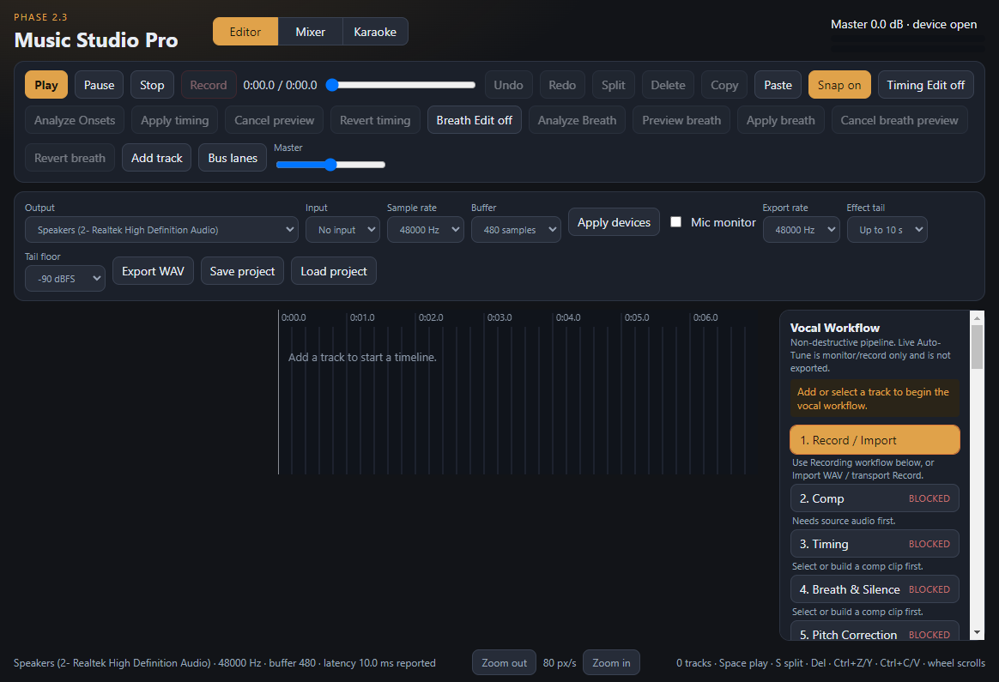

# Phase 2.7.2 — Input Gain & Recording Levels

**Status:** complete — STOP (await approval before 2.7.3 / packaging)  
**Baseline:** Phase 2.7.1 Recording Workflow (approved)

## 1. Verdict

Recording Workflow now shows **real** post-gain input Peak/RMS/dBFS meters (with peak hold and clip latch) and a clearly labeled **Input Gain** (−24…+24 dB, unity 0 dB) that feeds Live DSP and recording without touching track/master/Mic monitor paths. Levels are never fabricated; Unavailable is shown when no capture stream exists.

## 2. Architecture audit (what already existed)

| Area | Finding |
| --- | --- |
| WASAPI / JUCE capture | Existing `AudioDeviceManager` + `audioDeviceIOCallbackWithContext` |
| Recording callback | Existing `captureRecording` after Live DSP |
| Track / master gain | Existing `setTrack` / `setMaster` — **not** reused for input |
| Mic monitor | Raw device buffers (undelayed) — kept **pre** input gain |
| Strip meters | Peak-only track/bus/master via atomics → `meterVar` — **no** prior input meter |
| RMS | **Not** present on live path before 2.7.2 |
| Input / preamp gain | **None** before 2.7.2 |
| Recording Workflow panel | Phase 2.7.1 UI — extended, not duplicated |
| Engine IPC / EPIPE | Existing EngineHost rejection path preserved |

## 3. Signal flow

```
Device WASAPI / Virtual test signal
        │
        ├──────────────────────────────► Mic monitor (raw, pre-gain, undelayed)
        │
        ▼
 Software Input Gain (smoothed, −24…+24 dB, unity 0)
        │
        ├──────────────────────────────► Input meters (peak / RMS / hold / clip)
        │
        ▼
 Live pitch detect → Live Auto-Tune (optional)
        │
        ▼
 mixRoute (track monitor / faders) → captureRecording → take WAV
```

**Input gain position:** after capture / virtual generation, before Live DSP and recording. Applied once; no duplicate gain on the record path.

## 4. Metering implementation

- Audio thread: peak raise + sum-of-squares accumulate into atomics (`inputPeak*`, `inputSumSq*`, `inputMeterSamples`); preallocated `inputGainL/R` buffers; **no** heap alloc / **no** blocking IPC in the callback.
- Timer / `getMeters`: exchanges atomics, computes RMS, updates decaying display + peak-hold, emits `MeterEvent.input` (`InputMeter`).
- UI: `RecordingWorkflowPanel` — Peak/RMS dBFS, L/R bars when stereo, peak-hold needle, clip styling, guidance chip.
- Unavailable when `available === false` (no mic / no virtual / stream stopped).

## 5. Input gain

| Property | Behavior |
| --- | --- |
| Control | `setInputGain` `{ gainDb }` → `inputGainDb` / smoothed linear target |
| Range | −24 … +24 dB; unity **0 dB** |
| Smoothing | ~10 ms one-pole toward target (audio thread) |
| Independence | Does not change track Gain, master, or Mic monitor |
| Hardware clip | Documented: software gain **cannot** repair ADC clipping already in samples |

## 6. Threshold definitions (MSP defaults — not universal standards)

Defined in `apps/desktop/renderer/src/inputLevel.ts` as `INPUT_LEVEL_THRESHOLDS`:

| Guidance | Condition |
| --- | --- |
| Unavailable | `available !== true` |
| Signal too low | `peakDbFS < −40` |
| Healthy recording level | `−40 ≤ peakDbFS < −6` |
| Near clipping | `−6 ≤ peakDbFS < 0` |
| Clipping detected | engine `clip` latch or `peakDbFS ≥ 0` |

## 7. Real-time safety evidence

- Callback writes only into pre-sized `inputGainL/R` and atomics (`raisePeak` / CAS add / `fetch_add` on sample count).
- Meter JSON built on the timer / control thread via existing `meterVar` / `getMeters`.
- `inputMeterAvailable` cleared in `audioDeviceStopped`.
- EngineHost disconnect check: rejects without EPIPE (same pattern as 2.7.1).

## 8. Files changed

**Native**

- `native/audio-engine/include/msp/Engine.h` — input gain + meter atomics / buffers
- `native/audio-engine/src/Engine.cpp` — gain, meters, `setInputGain`, `MeterEvent.input`
- `native/audio-engine/tests/test_main.cpp` — `inputlevel` group

**Shared / renderer / electron**

- `packages/shared/src/protocol.ts` — `InputMeter`, `MeterEvent.input`, `inputGainDb`
- `apps/desktop/electron/protocol.ts` — optional `input` on events
- `apps/desktop/renderer/src/inputLevel.ts` (new) — thresholds / guidance
- `apps/desktop/renderer/src/RecordingWorkflowPanel.tsx` — meter + Input Gain UI
- `apps/desktop/renderer/src/App.tsx` — wire `inputMeter`
- `apps/desktop/renderer/src/styles.css`
- `apps/desktop/electron/inputLevel272Check.ts` (new) — `MSP_INPUT_LEVEL_272_CHECK`
- `apps/desktop/electron/main.ts` — check hook

**Docs**

- `docs/phase272-final-report.md` (this file)
- `docs/phase272-screenshots/`

No packaging. No Phase 2.7.3 work.

## 9. Screenshots




## 10. Exact tests executed

```
Executed:
- scripts\build-engine.ps1: exit 0
- audio_engine_tests.exe inputlevel: SUMMARY pass=15 fail=0 not_run=0
- npx tsc -p tsconfig.json --noEmit (apps/desktop): exit 0
- npx tsc -p tsconfig.electron.json --noEmit (apps/desktop): exit 0
- npm run build (apps/desktop): exit 0
- MSP_INPUT_LEVEL_272_CHECK=docs\phase272-screenshots
  (electron --user-data-dir=…\phase272-screenshots\electron-user-data):
  23 PASS, 0 FAIL, 1 NOT RUN, exit 0

Not run: full regression, other GUI checks, unrelated native groups
Microphone: NOT RUN — NO HARDWARE
```

### Native `inputlevel` (15 PASS)

Peak/RMS/dBFS math, gain mapping, smoothing, guidance thresholds, IPC unity/reject/independence, unavailable without input, virtual meters, clip detect, gain persists across record, record gain path (~×2 at +6 dB).

### `MSP_INPUT_LEVEL_272_CHECK` (23 PASS, 1 NOT RUN)

UI presence, gain/dBFS mapping, guidance transitions, EngineHost path, mono/stereo virtual channels, peak hold, record gain path, clip, monitor/master independence, gain smoothing settle, EPIPE-safe disconnect, UI Unavailable→healthy transition, unity reset, no console errors; live microphone NOT RUN.

## 11. Known limitations

- Software Input Gain cannot undo hardware ADC clipping.
- Guidance thresholds are product defaults, not claimed industry standards.
- Global Mic monitor remains raw/pre-gain by design (feedback safety / undelayed path).
- Virtual test signal only produces energy while transport is playing; meters read silence when stopped even if virtual is enabled.
- End-to-end hardware mic path: NOT RUN — NO HARDWARE.
- Input meter `channels` reports device channel count (or 2 for virtual); mono devices show L only.

## 12. STOP

Phase 2.7.2 complete. Do not begin Phase 2.7.3 or packaging without approval.
