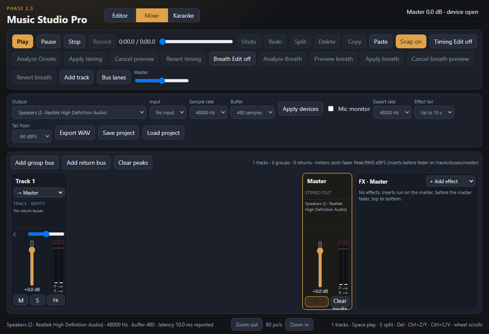

# Phase 2.7.3 — Mixer UX & Metering

**Status:** complete — STOP (await approval before 2.7.4 / packaging)  
**Baseline:** Phase 2.7.2 Input Gain & Recording Levels (approved)

## 1. Verdict

Mixer channel strips and Master now show real post-fader **Peak + RMS** in dBFS with peak hold and clip latch, Clear peaks action, and Unavailable when the engine/device stream is closed. Existing JUCE mix/routing/FX/automation were reused — no DSP rewrite. Meter updates use a publish/subscribe store so the Mixer shell is not force-rerendered on every meter tick.

## 2. Existing features reused

| Capability | Source |
| --- | --- |
| Track / bus / master strips | `Mixer.tsx` channel strips |
| Volume / pan / mute / solo | Existing `setTrack` / `setBus` / `setMaster` |
| Sends & routing | Existing MixPlan feeds |
| Insert effects | Existing FX rack (pre-fader on track/bus/master) |
| Peak atomics | Existing `sourcePeak` / `busPeak` / Engine `peakL/R` |
| Clip latch + reset | Existing `resetClips` (extended to clear peak hold) |
| Automation | Existing lanes; faders still disable when automated |
| Karaoke / recording | Untouched |

## 3. Mixer signal flow & meter tap points

```
Track media → [track inserts] → fader/pan → meterFeed ──► TRACK meter (post-fader, post-pan)
                      │
                      ├─ sends (pre/post) → return buses
                      ▼
Group/Return bus sum → [bus inserts] → bus gain/mute → meterFeed ──► BUS meter
                      ▼
Master sum → [master inserts] → (+ Mic monitor if on) → master fader ──► MASTER meter
```

| Meter | Tap point |
| --- | --- |
| Track | Post inserts, **post fader & pan** (`source.meterFeed`) |
| Bus | Post bus inserts, **post bus gain/mute** (`bus.meterFeed`) |
| Master | Post master inserts, after optional Mic monitor sum, **post master fader** |
| Input (2.7.2) | Separate path — post software input gain, pre Live DSP |

## 4. Metering implementation

- Audio thread: accumulate peak + sum-of-squares into MixState / Engine atomics (preallocated; no heap, no blocking IPC).
- Timer / `getMeters`: exchange atomics → RMS, decaying `level*`, peak-hold (~1 s then decay), clip latch, `peakDbFS` / `rmsDbFS`, `available` from `deviceOpen`.
- UI: Peak/RMS dBFS readout, L/R bars, peak-hold needle, clip LED; **Clear peaks** (toolbar + Master) calls `resetClips`.
- React: `meterStore` + `useSyncExternalStore` so only Meter components subscribe; App no longer `setState`s strip meters on every event.

## 5. Real-time safety evidence

- Callback only writes atomics / pre-sized MixState buffers.
- Meter JSON built on timer/control thread (`meterVar`).
- `available=false` when device closed; UI shows Unavailable (no fabricated levels).
- EngineHost disconnect check: rejects without EPIPE.

## 6. Files changed

**Native**

- `native/audio-engine/include/msp/Mixer.h` — MixState RMS slots; MixResult sumSq
- `native/audio-engine/src/Mixer.cpp` — RMS accumulate on meter feeds + master
- `native/audio-engine/include/msp/Engine.h` — PeakHoldState, master RMS atomics
- `native/audio-engine/src/Engine.cpp` — strip/master RMS + peak hold in `meterVar`; reset clears holds
- `native/audio-engine/tests/test_main.cpp` — `mixerux` group

**Shared / renderer / electron**

- `packages/shared/src/protocol.ts` — StripMeter RMS / hold / dBFS / available
- `apps/desktop/renderer/src/meterStore.ts` (new)
- `apps/desktop/renderer/src/Mixer.tsx` — Peak/RMS UI, Clear peaks, store subscription
- `apps/desktop/renderer/src/App.tsx` — `publishMeters`; `data-view="mixer"`
- `apps/desktop/renderer/src/styles.css`
- `apps/desktop/electron/mixerUx273Check.ts` (new) — `MSP_MIXER_UX_273_CHECK`
- `apps/desktop/electron/main.ts` — check hook

**Docs**

- `docs/phase273-final-report.md` (this file)
- `docs/phase273-screenshots/`

No packaging. No Phase 2.7.4 work.

## 7. Screenshots




## 8. Exact tests executed

```
Executed:
- scripts\build-engine.ps1: exit 0
- audio_engine_tests.exe mixerux: SUMMARY pass=3 fail=0 not_run=0
- npx tsc -p tsconfig.json --noEmit (apps/desktop): exit 0
- npx tsc -p tsconfig.electron.json --noEmit (apps/desktop): exit 0
- npm run build (apps/desktop): exit 0
- MSP_MIXER_UX_273_CHECK=docs\phase273-screenshots
  (electron --user-data-dir=…\phase273-screenshots\electron-user-data):
  16 PASS, 0 FAIL, 1 NOT RUN, exit 0

Not run: full regression, MSP_MIXER_CHECK (routing suite), other GUI checks, unrelated native groups
Microphone: NOT RUN — NO HARDWARE
```

### Native `mixerux` (3 PASS)

Strip Peak/RMS/hold/dBFS, clip + resetClips, mute/solo engine sync.

### `MSP_MIXER_UX_273_CHECK` (16 PASS, 1 NOT RUN)

Panel/Clear peaks, fader mapping, track/master meters, stereo, clip, reset, mute/solo engine + UI sync, gain ≈ −6 dB, EPIPE-safe disconnect, master clear action, no console errors; live microphone NOT RUN.

## 9. Known limitations

- Master meter includes Mic monitor when that path is enabled (existing mix order).
- Peak hold / clip can re-latch immediately if the strip is still above 0 dBFS after Clear peaks — lower the fader first for a lasting clear.
- Strip meters are stereo bars even for effectively mono content (both channels reported from the mix feed).
- Meter UI update rate follows the engine timer (~50 ms), not a separate UI throttle.
- Hardware microphone path: NOT RUN — NO HARDWARE.

## 10. STOP

Phase 2.7.3 complete. Do not begin Phase 2.7.4 or packaging without approval.
