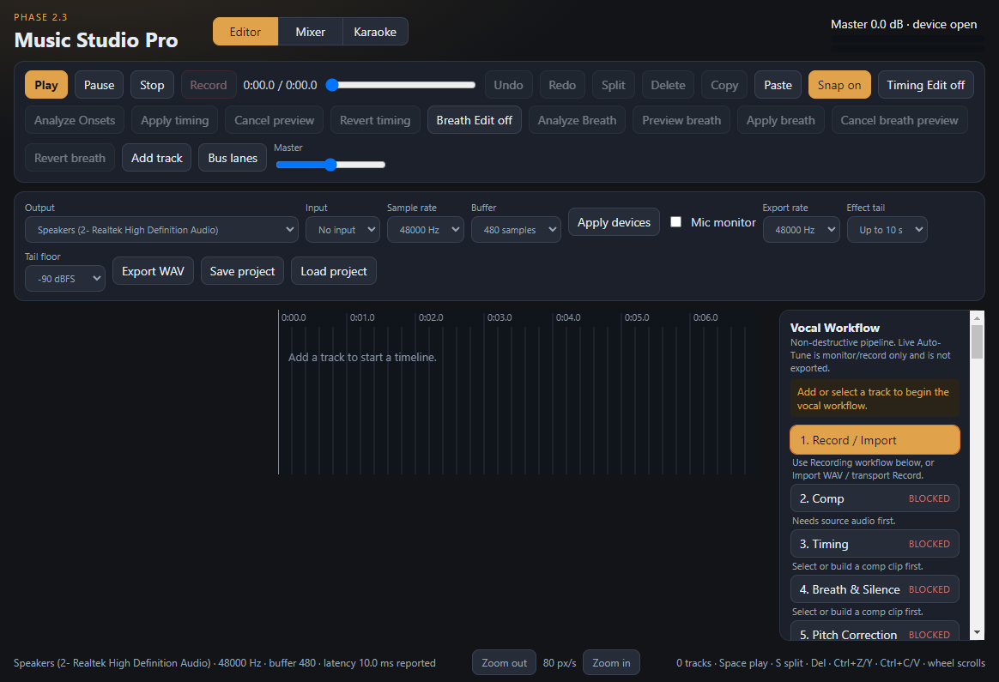

# Phase 2.7.4 — Recording Latency Calibration

**Status:** complete — STOP (await approval before 2.7.5 / packaging)  
**Baseline:** Phase 2.7.3 Mixer UX & Metering (approved)

## 1. Verdict

Recording take placement can now be aligned to backing-track playback via a signed millisecond **recording offset** (manual, persisted per device profile) and an optional offline **loopback correlation** estimate that never auto-applies unreliable results. Existing JUCE recording, transport, WASAPI device, and take/comp infrastructure were reused — no audio-engine rewrite. Existing takes are never moved.

## 2. Architecture audit — what was already compensated

| Delay | Before 2.7.4 | After 2.7.4 |
| --- | --- | --- |
| Output device latency (reported WASAPI) | Exposed in state; **not** applied to take placement | Still reported only; **not** auto-applied as placement offset (avoids double-counting with measured RTT) |
| Input device latency | Not separately reported / not applied to placement | Covered only via user/measured placement offset |
| Software buffering | Implicit in capture start = playhead at record start | Unchanged |
| Live Auto-Tune / insert DSP latency | Already present **inside** recorded samples when recording processed | Explicitly **not** subtracted again by placement offset |
| Recording placement vs playhead | `finishRecording` placed at uncompensated `recordStart` | `start = max(0, captureStart + offsetSamples)` for **new** takes only |
| Track monitoring path | Optional input monitor; separate from placement | Unchanged |
| Karaoke `recordOffsetSec` | Renderer-only Karaoke path | Untouched (Editor uses engine placement offset) |

**Already compensated (do not double-apply):** Live AT / processed-record DSP in the WAV content.  
**Not assumed equal:** Reported device latency ≠ measured round-trip latency.

## 3. Recording latency model

| Component | Meaning | How MSP treats it |
| --- | --- | --- |
| Input device latency | A/D + driver input buffer | Part of round-trip; compensated only via placement offset if user/measure includes it |
| Output device latency | D/A + driver output buffer | Reported (`reportedOutputLatencyMs`); not auto-applied to placement |
| Software buffering | Engine callback / queue | Capture timestamp = transport sample at record start |
| DSP processing latency | Live inserts on input path | Embedded in recorded audio when mode includes processed; not removed by offset |
| Recording placement offset | Timeline shift for **new** takes | `offsetMs` → samples at current rate; signed |
| Monitoring latency | What the performer hears | Separate from take placement; not altered by this phase |

## 4. Offset sign convention

- **Positive `offsetMs`** → place new takes **later** on the timeline.
- **Negative `offsetMs`** → place new takes **earlier**.
- If vocals sit **late** vs backing, use a **negative** offset.
- Loopback estimate: `delayMs > 0` means recorded signal lags reference → **suggested** `offsetMs = −delayMs` (apply is explicit).
- Range: **±500 ms**. Clamp + nearest-sample conversion at current sample rate.
- Existing takes / clips: **never** rewritten when offset changes.

## 5. Device profile persistence

- File: `Documents/Music Studio Pro/recording-latency.json`
- Key: `outputDevice + inputDevice + sampleRate + bufferSize` (`recordingLatencyProfileKey`)
- On `setRecordingOffset` / `resetRecordingOffset` / successful apply: save profile map
- On device `configure`: reload offset for the current key (default 0)
- Method tag: `none` | `manual` | `loopback-estimate`

## 6. Calibration implementation

### Manual

IPC: `getRecordingLatency`, `setRecordingOffset`, `resetRecordingOffset`  
UI: Recording Workflow panel (`data-recording-latency-274`) — signed ms control, reset, current offset, method, device config, last estimate, limitations.

### Optional loopback (correlation)

IPC: `estimateRecordingLatency` (reference WAV + recorded WAV) → `msp::estimateLatencyMono`  
IPC: `applyRecordingLatencyEstimate` — only if `reliable` (or `force: true`); never auto on estimate.  
UI documents authorized physical cable loopback. Automated physical loopback: **NOT RUN — NO HARDWARE**.  
No YouTube capture / system-audio interception.

### Placement

In `Engine::finishRecording` (control thread):

```
captureStart = recordStart
offsetSamples = recordingOffsetSamples(recordingOffsetMs, rate)
start = max(0, captureStart + offsetSamples)
```

Take payload exposes `captureStartSamples`, `placementOffsetMs`, `placementOffsetSamples`. Comping / importTake / seedComp paths receive the compensated `start` for new material only.

## 7. Real-time safety evidence

- Offset read/write and profile I/O on the **control** thread only.
- Correlation / WAV load only on control thread (`estimateRecordingLatency`).
- Audio callback still uses existing `recordStart` / recorder push; no heap correlation, no file I/O, no profile JSON on the audio thread.
- Changing offset rejected while recording is active.

## 8. Files changed

**Native**

- `native/audio-engine/include/msp/LatencyCalibration.h` (new)
- `native/audio-engine/src/LatencyCalibration.cpp` (new)
- `native/audio-engine/CMakeLists.txt` — MSP_SOURCES
- `native/audio-engine/include/msp/Engine.h` — offset / profiles / latency IPC helpers
- `native/audio-engine/src/Engine.cpp` — placement, IPC, persistence, `recordingLatencyVar`
- `native/audio-engine/tests/test_main.cpp` — `recordinglatency` group

**Shared / renderer / electron**

- `packages/shared/src/protocol.ts` — `RecordingLatencyState`, RecordTake placement fields, RecordState.latency
- `apps/desktop/renderer/src/RecordingWorkflowPanel.tsx` — calibration UI
- `apps/desktop/renderer/src/styles.css` — latency block styles
- `apps/desktop/electron/recordingLatency274Check.ts` (new) — `MSP_RECORDING_LATENCY_274_CHECK`
- `apps/desktop/electron/main.ts` — check hook

**Docs**

- `docs/phase274-final-report.md` (this file)
- `docs/phase274-screenshots/` (summary JSON + UI capture)

No packaging. No Phase 2.7.5 work.

## 9. Screenshots



## 10. Exact tests executed

```
Executed:
- scripts\build-engine.ps1: exit 0
- audio_engine_tests.exe recordinglatency: SUMMARY pass=19 fail=0 not_run=0
- npx tsc -p tsconfig.json --noEmit (apps/desktop): exit 0
- npx tsc -p tsconfig.electron.json --noEmit (apps/desktop): exit 0
- npm run build (apps/desktop): exit 0
- MSP_RECORDING_LATENCY_274_CHECK=docs\phase274-screenshots
  (electron --user-data-dir=…\phase274-screenshots\electron-user-data):
  18 PASS, 0 FAIL, 2 NOT RUN, exit 0

Not run: full regression, other GUI checks, unrelated native groups
Microphone: NOT RUN — NO HARDWARE
Physical loopback calibration: NOT RUN — NO HARDWARE
```

### Native `recordinglatency` (19 PASS)

Offset unity / ±10 ms @ 48k / 44.1k / clamp; samples↔ms; correlation lag + silence reject; profile key rate-sensitive; IPC default/reject/set/reset; estimate not auto-applied; apply estimate; invalid measurement; reject unreliable apply; placement at seek+offset; existing takes preserved.

### `MSP_RECORDING_LATENCY_274_CHECK` (18 PASS, 2 NOT RUN)

UI present; ms→samples sign; EngineHost; default 0; out-of-range reject; manual negative offset; profile persistence; sample-rate-aware samples (vs actual device rate); reset; synthetic correlation; apply → negative; invalid measurement; unreliable not applied; recording placement; existing take preservation; engine unavailable without EPIPE; UI offset/reset; no console errors; live mic NOT RUN; physical loopback NOT RUN.

## 11. Known limitations

- Reported WASAPI output latency is informational; users must calibrate (manual or loopback) for placement alignment.
- Device may keep its preferred sample rate/buffer when `configure` requests another rate — offset samples always follow the **actual** open rate.
- Seek clamps to timeline length; empty sessions cannot place mid-timeline until content extends the timeline (product behavior unchanged).
- Karaoke renderer `recordOffsetSec` remains separate from Editor engine placement offset.
- Physical loopback end-to-end with a cable: **NOT RUN — NO HARDWARE** (synthetic WAV correlation covered in tests).
- Offset does not rewrite historical takes; re-record or manually nudge clips if old material was misaligned.

## 12. STOP

Phase 2.7.4 complete. Do not begin Phase 2.7.5 or packaging without approval.
