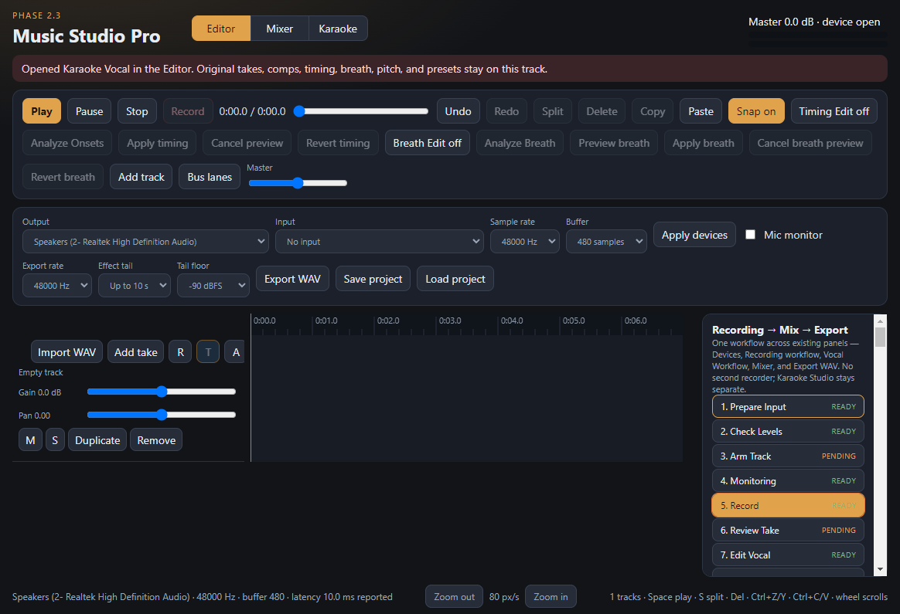
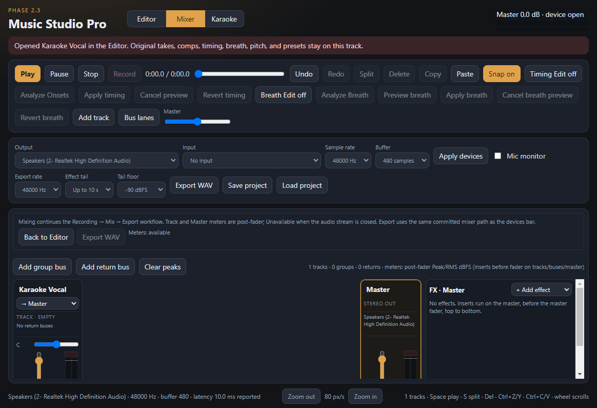

# Phase 2.7.5 — Recording & Mixing Integration

**Status:** complete — STOP (await approval before further phases / packaging)  
**Baseline:** Phase 2.7.4 Recording Latency Calibration (approved)

## 1. Verdict

Editor recording, input levels, monitoring, latency calibration, vocal editing, Mixer, and Export are tied into one navigational workflow without rewriting DSP or duplicating the recorder. Karaoke Studio remains a separate surface with Open Vocal in Studio preserved. No new algorithms; Electron/renderer integration only.

## 2. Integration architecture

```
Devices (Prepare Input / Apply devices / Mic monitor / Export WAV)
    ↓
Recording workflow 2.7.1–2.7.4 (levels, gain, latency, arm, monitor, record, review)
    ↓
Vocal Workflow 2.6 (comp → timing → breath → pitch → presets)
    ↓
Mixer 2.7.3 (levels / FX / meters)
    ↓
Export WAV (existing engine exportWav mixer path)
```

**Integration strip** `data-panel="recording-mix-workflow-275"` navigates only (scroll / `setView`). Canonical controls stay in existing panels.

## 3. Reused features

| Area | Source |
| --- | --- |
| Record / Review / Retake | `RecordingWorkflowPanel` + App transport |
| Input Gain & meters | Phase 2.7.2 |
| Latency offset / profiles | Phase 2.7.4 |
| Mixer Peak/RMS | Phase 2.7.3 |
| Vocal comp/timing/breath/pitch/presets | Phase 2.6 panels |
| Karaoke YouTube / Studio / Open Vocal | K1–K3 |
| Export | Engine `exportWav` (unchanged render path) |

## 4. Recording → export workflow (UI)

1. Prepare Input — devices panel  
2. Check Levels — Recording workflow Input Level / Gain  
3. Arm Track — lane R  
4. Monitoring — track monitor + Mic monitor  
5. Record — Recording workflow Start/Stop  
6. Review Take — Review / Retake  
7. Edit Vocal — Vocal Workflow / Comp  
8. Mix — Mixer view  
9. Export — devices-bar Export WAV (gated)

Vocal Workflow stage **Mix** opens Mixer; Mixer **Back to Editor** returns. Post-record stop expands take lanes and sets Comp stage.

## 5. State synchronization

| Concern | Behavior |
| --- | --- |
| Input device | Status prefers `state.inputDevice`; Apply devices syncs React device fields from engine |
| Input Gain | Still from `state.inputGainDb` + meter events |
| Recording offset | Active device profile; strip only navigates to latency UI |
| Monitoring | Engine `monitor` + per-track `monitorInput` unchanged |
| Take selection | Cleared if clip missing; post-record selects placed clip when present |
| Meters | Mixer shows available/unavailable from `deviceOpen` |
| Recording status | Existing Recording workflow status list |
| Engine disconnect | `engineConnected` flag on failed IPC; recording panel shows disconnect without requiring `state == null` |

## 6. Signal-path verification (boundaries preserved)

- Input Gain: capture path only (documented in Recording workflow).  
- Raw Mic monitor: separate undelayed path.  
- Track volume ≠ Master volume.  
- Mixer inserts applied once on their strips.  
- Placement offset: new takes only (2.7.4); never shifts existing takes.  
- Export: existing `exportWav` mixer render; blocked when disconnected, device closed, no audio, or vocal previews active.

## 7. Files changed

**Renderer**

- `apps/desktop/renderer/src/RecordingMixWorkflowPanel.tsx` (new)  
- `apps/desktop/renderer/src/App.tsx` — strip wiring, stage/mix navigation, export gates, disconnect flag, post-record handoff, Apply devices sync  
- `apps/desktop/renderer/src/RecordingWorkflowPanel.tsx` — `engineConnected`, effective input device  
- `apps/desktop/renderer/src/VocalWorkflowPanel.tsx` — mix-stage copy  
- `apps/desktop/renderer/src/Mixer.tsx` — integration banner, Back to Editor, Export  
- `apps/desktop/renderer/src/PitchPanel.tsx` — `data-panel="pitch-correction"`  
- `apps/desktop/renderer/src/styles.css`

**Electron**

- `apps/desktop/electron/recordingMixing275Check.ts` (new) — `MSP_RECORDING_MIXING_275_CHECK`  
- `apps/desktop/electron/main.ts` — check hook  

**Docs**

- `docs/phase275-final-report.md` (this file)  
- `docs/phase275-screenshots/`

No native engine changes. No packaging.

## 8. Screenshots





## 9. Exact tests executed

```
Executed:
- npx tsc -p tsconfig.json --noEmit (apps/desktop): exit 0
- npx tsc -p tsconfig.electron.json --noEmit (apps/desktop): exit 0
- npm run build (apps/desktop): exit 0
- MSP_RECORDING_MIXING_275_CHECK=docs\phase275-screenshots
  (electron --user-data-dir=…\phase275-screenshots\electron-user-data):
  19 PASS, 0 FAIL, 2 NOT RUN, exit 0

Not run: full regression, prior phase GUI suites (271–274), unrelated native groups, installer/release QA
Native rebuild: NOT RUN (renderer/Electron-only change)
Microphone: NOT RUN — NO HARDWARE
Physical loopback: NOT RUN — NO HARDWARE
```

### `MSP_RECORDING_MIXING_275_CHECK` (19 PASS, 2 NOT RUN)

Strip + reused panels; prepare navigation; gain/latency/monitor reachable; vocal mix → Mixer; meter availability; back to editor; empty export readiness; actionable export gate; device profile key; offset persistence across configure; monitoring + input gain sync; take/clip validity; disconnect without EPIPE; reconnect; Karaoke view; Karaoke→Studio; no console errors; mic/loopback NOT RUN.

## 10. Known limitations

- Integration strip navigates/focuses; it does not auto-arm tracks or auto-start recording.  
- Mixer view hides the Editor inspector strip until Back to Editor / Editor tab.  
- Export readiness is advisory in the UI attribute; the click path enforces gates with actionable errors.  
- Latency loopback estimate IPC remains manual/file-based (2.7.4); no new system-audio capture.  
- Changing input device name changes the latency profile key (by design); offsets do not migrate across keys.  
- Live microphone end-to-end: NOT RUN — NO HARDWARE.

## 11. STOP

Phase 2.7.5 complete. Do not begin another phase or packaging without approval.
