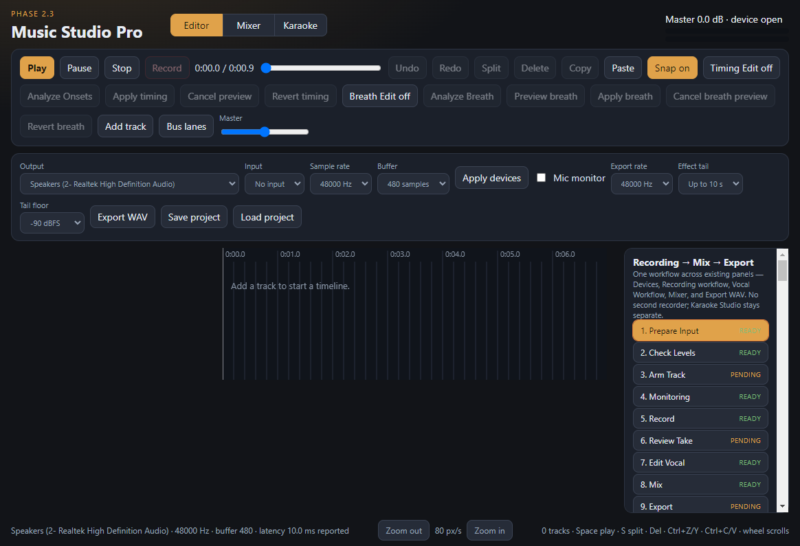

# Phase 2.8.1 — Audio Clip Time Stretch & Speed

**Status:** complete — STOP (await approval before 2.8.2 / packaging)  
**Baseline:** Phase 2.7 Recording & Mixing Integration (complete)

## 1. Verdict

Non-destructive clip **Time Stretch** (pitch-preserving) and **Speed** (pitch follows) are available from the Clip Inspector with Preview / Apply / Revert / Undo. Processing reuses the existing offline phase vocoder and `resampleStereo`; source WAVs are never overwritten. Edge-drag stretch was **not** added (conflicts with trim/fade hit targets).

## 2. Implementation approach (pre-change)

| Need | Approach |
| --- | --- |
| Pitch-preserving stretch 0.5×–2.0× | Reuse `msp::timeStretch` (validated **0.75–1.25** single-pass). Outside that window, **chain** passes — do not widen the vocoder’s single-pass range. |
| Speed 0.5×–2.0× | `msp::resampleStereo` at effective dest rate = sampleRate / speed; identity skip at 1.0×. |
| Non-destructive | Derived extras + `stretchOriginal*` provenance (same pattern as timing/breath/pitch). |
| Duration | Clip timeline `duration` becomes processed length (unlike timing warp which pads/crops). |
| Preview | Temporary clip mutation without undo; Cancel restores; Apply promotes with undo snapshot of pre-preview. |
| Re-apply | Always process from `stretchOriginal*` when set — no cumulative degradation. |
| Edge drag | Deferred — trim/fade already own edge hit targets. |

**Ratio conventions**

- **Duration ratio** (Time Stretch) = output_duration / original_duration (0.5 = half length, 2.0 = double).
- **Speed** multiplier: 2.0 = twice as fast → half duration; pitch rises with speed.

## 3. Reused DSP / infrastructure

- `msp::timeStretch` / phase-vocoder `Stretcher` (`PitchShift.cpp`)
- `msp::resampleStereo` (`WavIO`)
- Session extras, `editClip` / undo stacks, project extras serialization
- Clip fades / trim / placement (preserved; fades clamped to new duration)
- Export via existing `exportMix` (committed extras)

## 4. Signal processing architecture

```
Clip region (sourcePlay / extra play buffers)
    ├─ timeStretch → timeStretchClip (multi-pass 0.75–1.25) → derived WAV extra
    └─ speed       → speedChangeClip (resample)            → derived WAV extra
Clip points at extra; duration = output frames @ playback rate
stretchOriginal* remembers pre-process source for Revert / re-bake
```

No new realtime DSP path.

## 5. Audio quality / sample-count evidence

From `audio_engine_tests.exe clipstretch`:

| Check | Result |
| --- | --- |
| 1.1× stretch frames | 48000 → 52800 (exact expected) |
| Pitch preserve (440 Hz sine) | ~439.51 Hz → ~439.55 Hz (Δ &lt; 12 Hz) |
| 2.0× multi-pass frames | 48000 → 96000 |
| 2.0× speed frames | 48000 → 24000 |
| Speed pitch | ~439.5 Hz → ~879 Hz (~2×) |
| Identity speed | skipped (no processing) |

## 6. Non-destructive / preview / export

- Original files unchanged; extras under temp/managed paths.
- Preview does not push undo; Apply from preview snapshots pre-preview onto undo.
- Revert restores `stretchOriginal*`; fades kept.
- Re-apply from original provenance (speed after stretch uses original length, not half of stretched).
- Export ends stretch preview; uses committed mixer path.
- Save/load persists stretch metadata (project v6 additive).

## 7. Files changed

**Native**

- `native/audio-engine/include/msp/ClipStretch.h` / `src/ClipStretch.cpp` (new)
- `native/audio-engine/include/msp/Timeline.h`, `Project.h` — stretch fields
- `native/audio-engine/src/Session.cpp` / `Session.h` — preview/apply/revert
- `native/audio-engine/src/Engine.cpp` — IPC
- `native/audio-engine/src/Project.cpp` — serialize/load
- `native/audio-engine/CMakeLists.txt`
- `native/audio-engine/tests/test_main.cpp` — `clipstretch` group

**Shared / desktop**

- `packages/shared/src/protocol.ts`
- `apps/desktop/renderer/src/ClipStretchPanel.tsx` (new)
- `apps/desktop/renderer/src/App.tsx`, `styles.css`
- `apps/desktop/electron/clipStretch281Check.ts` (new)
- `apps/desktop/electron/main.ts`

**Docs**

- `docs/phase281-final-report.md`, `docs/phase281-screenshots/`

## 8. Screenshots



## 9. Exact tests executed

```
Executed:
- scripts\build-engine.ps1: exit 0
- audio_engine_tests.exe clipstretch: SUMMARY pass=20 fail=0 not_run=0
- npx tsc -p tsconfig.json --noEmit: exit 0
- npx tsc -p tsconfig.electron.json --noEmit: exit 0
- npm run build (apps/desktop): exit 0
- MSP_CLIP_STRETCH_281_CHECK=docs\phase281-screenshots:
  9 PASS, 0 FAIL, 2 NOT RUN, exit 0

Not run: full regression, prior phase suites, unrelated native/GUI groups, installer QA
Microphone: NOT RUN — NO HARDWARE
Edge-drag stretch: NOT RUN — deferred (trim/fade conflict)
```

## 10. Known limitations

- Single-pass vocoder remains 0.75–1.25; wider ratios use multi-pass (possible accumulated artifacts).
- Stretch/speed clears timing markers, breath, and offline pitch provenance (source remapped); revert those stages first if needed before stretch.
- No modifier edge-drag stretch (inspector only).
- Very short clips (&lt; 32 samples) refuse time-stretch.
- UI controls disable until a clip is selected.

## 11. STOP

Phase 2.8.1 complete. Do not begin Phase 2.8.2 or packaging without approval.
