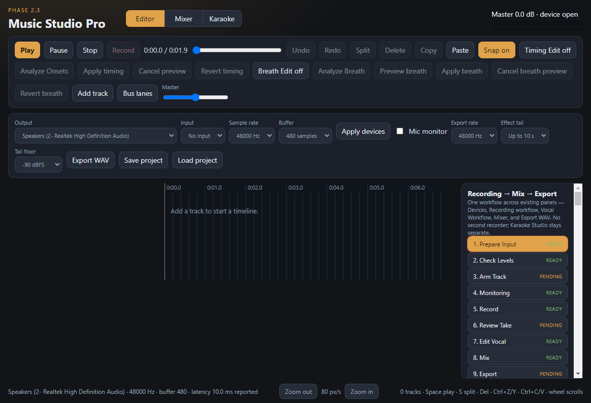

# Phase 2.8.2 — Advanced Crossfade & Clip Editing

**Status:** complete — STOP (await approval before 2.8.3 / packaging)  
**Baseline:** Phase 2.8.1 Clip Stretch (approved)

## 1. Verdict

Editable **crossfades** between overlapping or abutting clips on the same track, with **Linear / Equal Power / S-Curve** envelopes, Inspector Preview / Apply / Revert / Reset, optional **auto-crossfade** on move/trim, Undo/Redo, and project persistence. Processing reuses the existing single `fadeEnvelope` path in `renderArrangement` — no second clip engine and no double fade gain.

## 2. Architecture audit (what already existed)

| Capability | Pre-2.8.2 status |
| --- | --- |
| Per-clip fade-in / fade-out (seconds + samples) | Yes — linear only via `fadeEnvelope` |
| Vocal-comp abutting fades (`kDefaultCompCrossfadeMs` = 5 ms) | Yes — still linear complementary fades |
| Timeline overlap summing | Yes — clips sum in `renderArrangement` |
| Trim / split / move / selection / undo | Yes |
| Waveform fade handles | Yes |
| Linked editable crossfade + curve types | **Missing** → added |
| Auto-crossfade on move/trim | **Missing** → added (opt-in) |
| Crossfade Inspector Preview/Apply/Revert | **Missing** → added |

**Approach:** extend `fadeEnvelope` with curves; store complementary `fadeOut`/`fadeIn` + curve + partner ids on clips; optional track auto settings. No schema version bump (project v6 additive fields).

## 3. Fade curve mathematics

Normalized progress \(t \in [0,1]\):

| Curve | Fade-in \(g_{\mathrm{in}}(t)\) | Fade-out \(g_{\mathrm{out}}(t)\) |
| --- | --- | --- |
| **Linear** | \(t\) | \(1 - t\) |
| **Equal Power** | \(\sin(\pi t / 2)\) | \(\cos(\pi t / 2)\) |
| **S-Curve** | smoothstep \(3t^2 - 2t^3\) | smoothstep\((1-t)\) |

**Normalization / amplitude**

- Envelope output is clamped to \([0,1]\) and multiplied once by clip gain — never applied twice.
- Equal Power: \(g_{\mathrm{in}}^2 + g_{\mathrm{out}}^2 = 1\) → constant **power** for **uncorrelated** signals.
- **Correlated** overlaps (same source / phase-aligned) can still sum louder than either solo; the UI documents this. No unexpected boost is introduced beyond ordinary additive mixing.

## 4. Timeline interaction

- Apply clamps duration to overlap (if any) and half of each clip (sample-accurate).
- Moving / trimming reconciles partner links; broken pairs drop link metadata.
- Auto-crossfade (off by default): after move/trim, applies default duration/curve to neighbor overlaps; skips vanishing overlaps (&lt; 2 samples).
- Preview mutates fades without undo; Cancel restores; Apply promotes with undo snapshot (same pattern as stretch).
- Trim / fade handles and stretch controls remain separate; crossfade uses complementary fades, not a new hit target.

## 5. Playback / export consistency

- Playback and export both call `renderArrangement` → same `fadeEnvelope` with clip curves.
- Mono/stereo: L/R share the same envelope; arrangement sum is finite under equal-power overlap.
- Effects / automation / pitch / stretch / vocal-comp paths unchanged.

## 6. Persistence

Additive project v6 fields (absent → defaults):

- Clip: `fadeInCurve`, `fadeOutCurve`, `crossfadePartnerId`, `crossfadeCurve`, `crossfadeDuration`
- Track: `autoCrossfadeEnabled`, `autoCrossfadeMs`, `autoCrossfadeCurve`

Original source files, trim ranges, position, pitch, stretch, comp, and automation are untouched by crossfade edits (metadata + envelopes only).

## 7. Files changed

**Native**

- `native/audio-engine/include/msp/Crossfade.h` / `src/Crossfade.cpp` (new)
- `native/audio-engine/include/msp/Timeline.h` / `src/Timeline.cpp` — `FadeCurve`, curved `fadeEnvelope`
- `native/audio-engine/include/msp/Project.h` / `src/Project.cpp` — persistence
- `native/audio-engine/include/msp/Session.h` / `src/Session.cpp` — preview/apply/revert/auto + move/trim hooks
- `native/audio-engine/src/Engine.cpp` — IPC + state
- `native/audio-engine/CMakeLists.txt`
- `native/audio-engine/tests/test_main.cpp` — `crossfade` group

**Desktop**

- `apps/desktop/renderer/src/CrossfadePanel.tsx` (new)
- `apps/desktop/renderer/src/App.tsx`, `styles.css`
- `apps/desktop/renderer/src/ClipStretchPanel.tsx` — null-safe label (tsc)
- `apps/desktop/electron/crossfade282Check.ts` (new)
- `apps/desktop/electron/main.ts`
- `packages/shared/src/protocol.ts`

**Docs**

- `docs/phase282-final-report.md`, `docs/phase282-screenshots/`

## 8. Tests executed

```
Executed:
- scripts\build-engine.ps1: exit 0
- build\audio_engine_tests.exe crossfade: SUMMARY pass=24 fail=0 not_run=0
- npx tsc -p tsconfig.json --noEmit: exit 0
- npx tsc -p tsconfig.electron.json --noEmit: exit 0
- npm run build (desktop): exit 0
- MSP_CROSSFADE_282_CHECK=docs\phase282-screenshots: pass=14 fail=0 not_run=1
Not run: full regression, other GUI checks, unrelated native test groups, previous phase suites, installer/release QA
Microphone: NOT RUN — NO HARDWARE
```

### Native (`crossfade`) — all PASS

Curve math, overlap clamp, reject non-overlap, reconcile, auto skip/apply, render safety, IPC preview/apply/undo/auto/save-load/export/bad-curve.

### GUI (`MSP_CROSSFADE_282_CHECK`) — 14 PASS, 1 NOT RUN

Inspector controls, preview/cancel/apply, undo/redo, auto on move, revert, invalid overlap, save/load, export, no console errors; microphone NOT RUN.



## 9. Known limitations

- Crossfade is **same-track** neighbor pairs only (no cross-track links).
- Auto-crossfade applies to **all** touching neighbors after move/trim when enabled — not selective per pair.
- Equal Power does not guarantee constant loudness for highly correlated overlaps.
- Edge-drag stretch remains deferred (2.8.1); fade handles unchanged.
- Vocal-comp 5 ms abut fades remain linear unless the user applies a curved crossfade afterward.

## 10. Stop

Phase 2.8.2 complete. Do **not** begin Phase 2.8.3 or packaging without approval.
