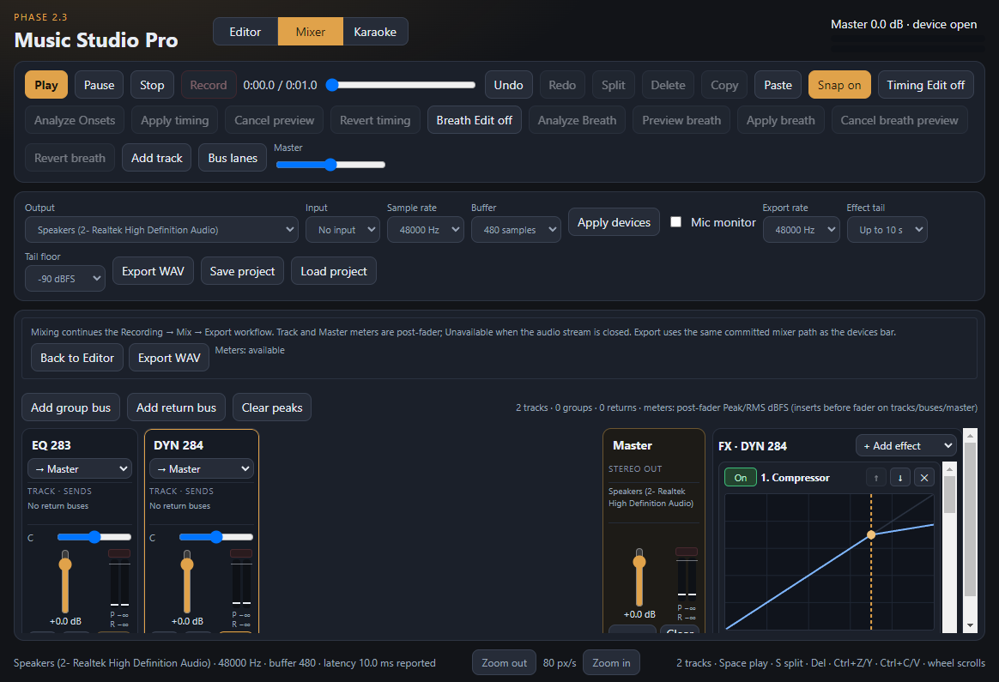

# Phase 2.8.3 — Parametric EQ & Spectrum Analyzer

**Status:** complete — STOP (await approval before 2.8.4 / packaging)  
**Baseline:** Phase 2.8.2 Advanced Crossfade (approved)

## 1. Verdict

The existing 4-band RBJ `EqDsp` is extended (not replaced) with per-band **enable**, a **visual frequency-response editor**, and a **realtime FFT spectrum** tapped **post-insert / pre-fader**. Playback and export continue to share the same insert chain; older projects load with equivalent flat EQ (new enable flags default on).

## 2. Architecture audit (reused)

| Component | Status |
| --- | --- |
| 4-band EQ (`EqDsp`, JUCE `ArrayCoefficients`) | Reused |
| Params `bandNType/Freq/Gain/Q`, `outputGain` | Reused |
| Insert chains / track·bus·master routing | Reused |
| Automation `fx:<id>:<param>` | Reused (choice params still excluded) |
| Strip meters + `meterStore` / 50 ms timer | Reused pattern |
| `msp::Fft` | Reused on **control thread** only |
| `eqBandMagnitude` | Extended → `eqCompositeDb` / `eqResponseCurve` |
| Visual EQ + spectrum | **Added** |

## 3. EQ filter architecture

- Serial Direct-Form-II biquads (low shelf / bell / high shelf), ~10 ms param smoothing, 0 dB / disabled bands skipped (unity).
- Additive params: `band1Enabled`…`band4Enabled` (indices 17–20; `kMaxEffectParams` 17→21). Missing on load → default **1** (on).
- Effect-level bypass unchanged (`ProjectEffect.enabled` wet/dry crossfade).

## 4. Frequency-response calculation

- Native: same coeffs as DSP via `designBand` → complex magnitude → dB product × `outputGain`.
- UI: RBJ cookbook in `eqResponse.ts` (matched to JUCE); `getEqResponse` IPC for verification.
- Graph: log Hz axis, ±24 dB gain, draggable handles (freq/gain; Shift = Q), numeric fields, Reset, Bypass.

## 5. FFT analyzer design

| Item | Value |
| --- | --- |
| FFT size | **2048** (documented / reported) |
| Ring | 8192 mono samples, lock-free overwrite |
| Display bins | 128 log-spaced 20 Hz–20 kHz |
| Smoothing | EMA `kSpectrumSmooth = 0.65` |
| Update | Engine timer **50 ms** (with meters) |
| Mono/stereo | `(L+R)/2` into ring |

**Unavailable** when device closed, tap cleared, or insufficient history — UI shows no fabricated spectrum.

## 6. Signal tap points

```
Track/Bus/Master audio
  → insert chain (EQ here when present)     ← SPECTRUM TAP (post-EQ if EQ is last/only)
  → fader / pan / sends / master gain
```

- `setSpectrumTap { target: track|bus|master, ownerId }`
- One tap at a time; opening an EQ editor selects that owner’s post-insert stream.
- No double EQ processing; analyzer is observe-only.

## 7. Real-time safety evidence

- Audio callback: `SpectrumCapture::writeStereo` only (no FFT, no alloc, no locks).
- FFT/`Fft::transform` on control thread after `prepare()` in `Engine` ctor.
- Device restart clears the ring (`openDevices`).
- Renderer: `spectrumStore` isolates updates (meterStore pattern).

## 8. Playback / export / compatibility

- EQ params affect both live mix and `exportWav` offline `mixRoute` (identical `EqDsp`).
- Bypass consistent (effect enable + per-band enable).
- Project v6 additive named params — no schema bump; old projects flatten as before.

## 9. Files changed

**Native:** `Effects.h/cpp`, `SpectrumAnalyzer.h/cpp` (new), `Mixer.h/cpp`, `Engine.h/cpp`, `CMakeLists.txt`, `tests/test_main.cpp` (`parametriceq`)

**Desktop:** `ParametricEqEditor.tsx`, `eqResponse.ts`, `spectrumStore.ts`, `Mixer.tsx`, `effects.ts`, `App.tsx`, `styles.css`, `protocol.ts`, `parametricEq283Check.ts`, `main.ts`

**Docs:** `docs/phase283-final-report.md`, `docs/phase283-screenshots/`

## 10. Tests executed

```
Executed:
- scripts\build-engine.ps1: exit 0
- build\audio_engine_tests.exe parametriceq: SUMMARY pass=15 fail=0 not_run=0
- npx tsc -p tsconfig.json --noEmit: exit 0
- npx tsc -p tsconfig.electron.json --noEmit: exit 0
- npm run build (desktop): exit 0
- MSP_PARAMETRIC_EQ_283_CHECK=docs\phase283-screenshots: pass=11 fail=0 not_run=1
Not run: full regression, other GUI checks, unrelated native groups, previous phase suites, installer/release QA
Microphone: NOT RUN — NO HARDWARE
```

### Native (`parametriceq`) — all PASS

Defaults, flat/boost/bypass/Q response, spectrum prepare/silence/FFT peak ~1 kHz, unavailable when closed, IPC add/response/spectrum/save-load/export.

### GUI (`MSP_PARAMETRIC_EQ_283_CHECK`) — 11 PASS, 1 NOT RUN

Response mapping, band bypass, spectrum on/off, editor controls, Reset, save/load, export, engine-unavailable; microphone NOT RUN.



## 11. Known limitations

- Spectrum reflects the **owner strip post-insert**, not a single EQ plugin’s private wet bus when other inserts follow.
- UI response uses cookbook RBJ; tiny numerical differences vs native `getEqResponse` possible at extreme Q/freq.
- Analyzer update rate follows the 50 ms meter timer (not sample-accurate UI).
- Band enable is additive; very old hosts that hard-code 17 params would ignore enables (this codebase updated).

## 12. Stop

Phase 2.8.3 complete. Do **not** begin Phase 2.8.4 or packaging without approval.
