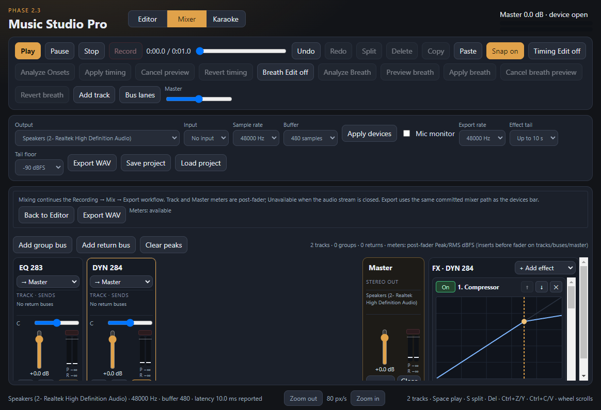

# Phase 2.8.4 — Advanced Compressor & Limiter

**Status:** complete — STOP (await approval before 2.8.5 / packaging)  
**Baseline:** Phase 2.8.3 Parametric EQ & Spectrum Analyzer (approved)

## 1. Verdict

Existing feed-forward stereo-linked `CompressorDsp` is extended (not replaced) with additive **soft knee**, a **visual input→output transfer curve**, **GR metering with peak hold**, and a new **sample-peak stereo-linked limiter** insert. Older projects load with hard-knee compressor behavior unchanged (`knee` defaults to 0).

## 2. Architecture audit (reused)

| Component | Status |
| --- | --- |
| `CompressorDsp` (peak detector, attack/release, makeup) | Reused + knee |
| Params threshold / ratio / attack / release / makeup | Reused |
| Insert chains track · bus · master | Reused |
| Effect bypass wet/dry crossfade | Reused |
| Automation `fx:<id>:<param>` | Reused |
| Effect `reduction` meter in mixer IPC | Reused |
| Playback / export same `MixPlan` DSP | Reused |
| Soft knee, transfer APIs, limiter type, dynamics UI | **Added** |

## 3. Compressor transfer function

Steady-state gain computer (dB), stereo-linked peak:

- `slope = 1 − 1/ratio`
- `over = levelDb − threshold`
- **Hard knee** (`knee == 0`, legacy): `GR = over > 0 ? over · slope : 0`
- **Soft knee** (`knee > 0`):  
  - `over ≤ −knee/2` → 0  
  - `over ≥ +knee/2` → `over · slope`  
  - else → `slope · (over + knee/2)² / (2 · knee)`
- Output: `inputDb − GR + makeup`
- Envelope: one-pole attack/release on GR; makeup ~3 ms glide

UI / `getDynamicsCurve` use the same formulas (`compressorTransferDb`).

## 4. Limiter architecture

New `EffectType::limiter` / `LimiterDsp`:

| Item | Value |
| --- | --- |
| Kind | **Sample-peak** brickwall (not true-peak) |
| Link | Stereo max(|L|,|R|) |
| Params | `ceiling` (−24…0 dB, default −0.3), `release`, `attack` |
| Lookahead | **None** — latency **0 samples** |
| True-peak | **Not implemented** — inter-sample peaks may exceed ceiling |

Static curve clamps output at ceiling; dynamic path smooths linear gain with attack/release.

## 5. Gain-reduction meter

- DSP returns max GR (dB) per audio block (compressor and limiter).
- Mixer publishes via existing `effects[].reduction` meter events (~50 ms).
- UI: live GR bar + decaying peak-hold; bypassed shows **BYP / bypassed** (no fabricated GR).

## 6. Real-time safety evidence

- No allocation / locks / IPC in `CompressorDsp::process` or `LimiterDsp::process`.
- Parameter ranges sanitized on control thread; NaN/Inf samples coerced to 0; gain forced finite.
- Variable block sizes supported (per-sample loop).
- Limiter adds no PDC / latency reporting change.

## 7. Playback / export / compatibility

- Same insert DSP for live mix and `exportWav`.
- Additive compressor param `knee` (index 5, default 0) — old projects omit it → hard knee.
- New `limiter` type is additive; unknown to older hosts only if they lack the enum (this tree updated).
- Bypass via `ProjectEffect.enabled` unchanged.

## 8. Files changed

**Native:** `Effects.h/cpp`, `Engine.cpp`, `tests/test_main.cpp` (`dynamics` group)

**Desktop:** `dynamicsTransfer.ts`, `DynamicsEditor.tsx`, `effects.ts`, `Mixer.tsx`, `styles.css`, `protocol.ts`, `fxCheck.ts`, `dynamics284Check.ts`, `main.ts`

**Docs:** `docs/phase284-final-report.md`, `docs/phase284-screenshots/`

## 9. Tests executed

```
Executed:
- scripts\build-engine.ps1: exit 0
- build\audio_engine_tests.exe dynamics: SUMMARY pass=24 fail=0 not_run=0
- npx tsc -p tsconfig.json --noEmit: exit 0
- npx tsc -p tsconfig.electron.json --noEmit: exit 0
- npm run build (desktop): exit 0
- MSP_DYNAMICS_284_CHECK=docs\phase284-screenshots: pass=14 fail=0 not_run=1
Not run: full regression, other GUI checks, unrelated native groups, previous phase suites, installer/release QA
Microphone: NOT RUN — NO HARDWARE
```

### Native (`dynamics`) — all PASS

Defaults/hard knee, soft knee midpoint, makeup, attack/release fractions, stereo link, silence, NaN, extreme input, limiter ceiling/stereo peak, legacy knee=0, makeup smoothing, transfer API, IPC add/curve/save-load/export.

### GUI (`MSP_DYNAMICS_284_CHECK`) — 14 PASS, 1 NOT RUN

Threshold/ratio, soft knee, makeup curve, limiter sample-peak, live GR, editor controls, bypass, reset, save/load, export, engine-unavailable; microphone NOT RUN.



## 10. Known limitations

- Limiter is **sample-peak only** — no oversampled true-peak detection or limiting.
- No lookahead → possible overshoot on very fast edges within one attack window.
- Static transfer curve ignores attack/release (steady-state only).
- Soft-knee projects are not readable by hosts that hard-code 5 compressor params (this codebase accepts 6).

## 11. Stop

Phase 2.8.4 complete. Do **not** begin Phase 2.8.5 or packaging without approval.
