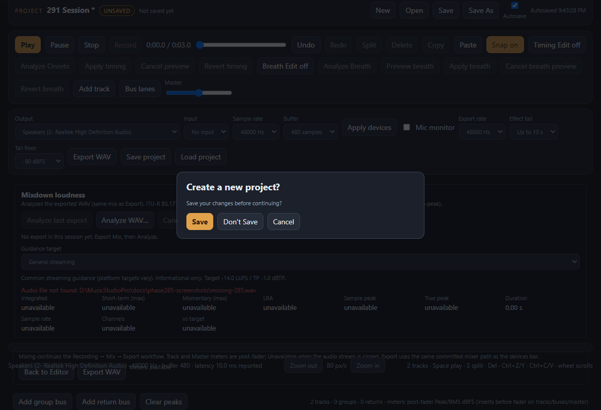

# Phase 2.8.5 — Mixdown & Loudness Analysis

**Status:** complete — STOP (await approval before further phases / packaging)  
**Baseline:** Phase 2.8.4 Advanced Compressor & Limiter (approved)

## 1. Verdict

Offline **ITU-R BS.1770-4 / EBU R128** loudness analysis runs on the **exported WAV** (same mix path as Export: master FX, tails, automation). The UI shows integrated / short-term / momentary LUFS, LRA, sample peak, **4× true peak (dBTP)**, duration/rate/channels, clipping warnings, and informational targets. The Phase 2.8.4 limiter remains **sample-peak only** and is not relabeled.

## 2. Architecture audit (reused)

| Component | Status |
| --- | --- |
| `exportWav` / `Session::exportMix` | Reused (unchanged defaults) |
| Master inserts / compressor / limiter | Included in export; not rewritten |
| `WavIO::readWavFile` / write | Reused for analysis input |
| Async job pattern (`PitchJob` / events) | Reused for loudness worker |
| Strip meters (live RMS/peak) | Not used as LUFS substitute |
| Loudness DSP + IPC + panel | **Added** |

## 3. Loudness algorithm

- **K-weighting:** BS.1770-4 Annex 1 high shelf + RLB high-pass (bilinear at file rate).
- **Blocks:** 400 ms mean-square, 100 ms hop (75% overlap).
- **Momentary:** max 400 ms block LUFS over the file.
- **Short-term:** max 3 s sliding mean of block energies.
- **Integrated:** absolute gate −70 LUFS, relative gate −10 LU, then −0.691 + 10·log10(gated mean square).
- **LRA:** EBU Tech 3342 on short-term values (abs −70, rel −20 LU; 10th–95th percentile).
- **Channel weights:** 1.0 for L/R; mono uses one channel.
- Silence / sub-momentary files → LUFS **unavailable**; peaks still reported when possible.

## 4. True peak

| Item | Value |
| --- | --- |
| Oversampling | **4×** (documented) |
| Method | Zero-stuff + Hann-windowed sinc FIR (49 taps), offline |
| Unit | dBTP |
| Limiter | Still sample-peak — analysis only |

## 5. Export integration

```
Export Mix (existing exportWav)
  → Analyze Rendered WAV (analyzeLoudness async)
  → Loudness panel report (repeatable / cancellable)
```

- Analysis reads the written file (not a parallel render).
- Worker thread + `loudnessProgress` / `loudnessResult` — renderer not blocked on DSP.
- Auto-starts after a successful Export; “Analyze last export” / “Analyze WAV…” available.

## 6. Reference fixture results (±0.15 LU integrated)

Stereo 1 kHz sine, peak −20 dBFS, 48 kHz, 5 s:

| Metric | Expected | Measured |
| --- | --- | --- |
| Integrated | −0.691 − 20 + K(1 kHz) ≈ **−20.037** | **−20.037** |
| Mono vs stereo | −3.01 LU | PASS |
| Absolute gate @ −80 dBFS peak | integrated invalid | PASS |
| Silence | unavailable | PASS |
| Alternating ±1 true peak | TP > sample peak | PASS (+1.35 dB) |

## 7. Files changed

**Native:** `Loudness.h/cpp` (new), `Engine.h/cpp`, `CMakeLists.txt`, `tests/test_main.cpp` (`loudness`)

**Desktop:** `LoudnessPanel.tsx`, `loudnessTargets.ts`, `App.tsx`, `styles.css`, `protocol.ts` (shared), `loudness285Check.ts`, `main.ts`

**Docs:** `docs/phase285-final-report.md`, `docs/phase285-screenshots/`

## 8. Tests executed

```
Executed:
- scripts\build-engine.ps1: exit 0
- build\audio_engine_tests.exe loudness: SUMMARY pass=18 fail=0 not_run=0
- npx tsc -p tsconfig.json --noEmit: exit 0
- npx tsc -p tsconfig.electron.json --noEmit: exit 0
- npm run build (desktop): exit 0
- MSP_LOUDNESS_285_CHECK=docs\phase285-screenshots: pass=13 fail=0 not_run=1
Not run: full regression, other GUI checks, unrelated native groups, previous phase suites, installer/release QA
Microphone: NOT RUN — NO HARDWARE
```

### Native (`loudness`) — all PASS

Integrated/momentary/short-term sine, mono/stereo, gating, silence, short file, sample/true peak, inter-sample TP, LRA, NaN, IPC export/analyze/cancel/missing.

### GUI (`MSP_LOUDNESS_285_CHECK`) — 13 PASS, 1 NOT RUN

Export→analyze, TP factor 4, silence/short/cancel/repeat/missing, panel controls, engine-unavailable; microphone NOT RUN.



## 9. Known limitations

- True-peak FIR is practical 4× analysis, not AES17 certification hardware.
- Momentary/short-term UI values are **max over the file**, not a live scrolling meter.
- Targets are guidance only — no auto-normalize.
- Very short files (<400 ms) cannot produce gated integrated LUFS.

## 10. Stop

Phase 2.8.5 complete. Do **not** begin another phase or packaging without approval.
