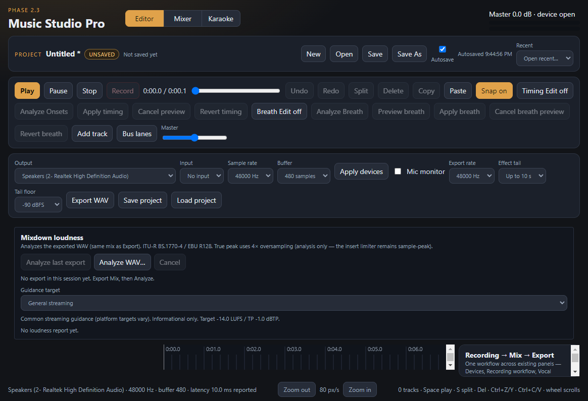
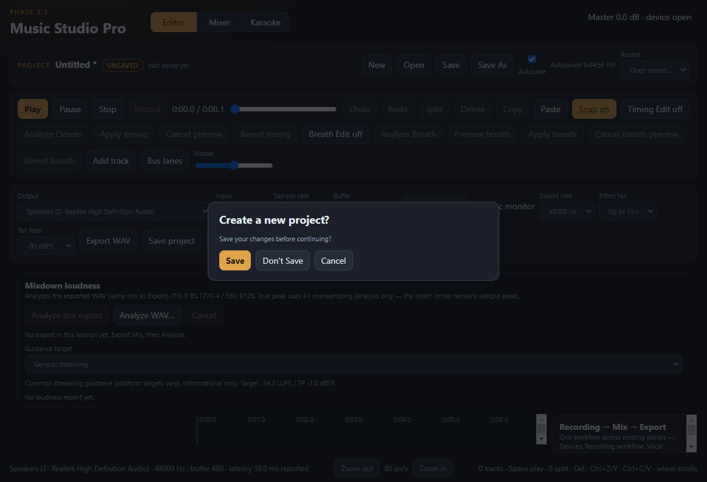

# Phase 2.9.1 — Project Management & Autosave

**Status:** complete — STOP (await approval before Phase 2.9.2 / packaging)  
**Baseline:** Phase 2.8 complete (approved)

## 1. Verdict

Project management now covers New / Open / Save / Save As, recent projects, dirty-state tracking, configurable autosave snapshots (separate from manual saves), recovery offers, and unsaved-change protection on quit / new / open. Schema remains **project version 6** with additive `projectId` / `projectName` only.

## 2. Architecture audit (existing → reused)

| Capability | Pre-2.9.1 | 2.9.1 action |
| --- | --- | --- |
| Schema v6 `saveProjectFile` / `loadProjectFile` | Present | Extended with identity + atomic publish |
| Engine `saveProject` / `loadProject` | Present | Added `newProject`, `setProjectMeta`; identity in state |
| Electron file dialogs | Present | Reused; recovery Save-As dialog added |
| Undo/Redo | Present | Marks dirty via mutating-op set |
| Dirty-state | Missing (vocal-preset hint only) | **Added** generation-based dirty |
| Autosave / recovery | Missing | **Added** |
| Recent projects | Missing | **Added** |
| Quit unsaved guard | Missing (`window-all-closed` only) | **Added** close handshake |
| Media refs in project JSON | Paths only (no audio copy) | Preserved |

## 3. Project identity

- Stable UUID (`makeProjectId()` / JUCE `Uuid`) stored as additive `projectId`.
- Display name as additive `projectName` (default `Untitled`).
- Missing identity on load → generated (backward compatible); never bumps schema version.
- Autosave / recovery folders key off `projectId`, not the filename.

## 4. Autosave storage

- Root: `{userData}/autosave/{projectId}/` (override via `MSP_PROJECT_DATA_ROOT` for tests).
- Files: `snapshot-<ISO>.msp.json` + `meta.json` (name, original path, timestamp).
- Defaults: enabled, **120 s** interval, only when dirty, skip while recording or overlapping save.
- Does **not** clear dirty; does **not** overwrite the manually saved `.json` path.
- Engine `saveProject` writes the snapshot (message-thread); audio thread untouched.

## 5. Atomic-write strategy

1. Serialize project JSON.
2. Parse-validate before publish.
3. Write sibling temp file.
4. Replace destination (`delete` + `move`, with copy fallback).
5. Retention prune runs only after a new valid snapshot is committed.

## 6. Snapshot retention

- Keep up to **10** snapshots per `projectId`.
- Oldest removed only after a new valid snapshot is safely written.
- Failed publish does not delete the latest valid snapshot.

## 7. Dirty-state

- Renderer tracks `dirtyGeneration` / `savedGeneration`.
- Mutating engine ops (clips, mixer, FX, automation, vocal, stretch, record stop, undo/redo, …) bump dirty.
- UI-only actions (selection, scroll, transport seek/play) do not.
- Manual save clears dirty only if generation is unchanged since save start (edits mid-save keep dirty).
- Autosave never clears dirty.

## 8. Recovery workflow

1. Startup scans autosave roots → recovery dialog (name, timestamp, original path, availability).
2. **Recover** → Save working copy via dialog → open copy (original untouched).
3. **Discard** → delete that project’s snapshots after confirm intent.
4. **Decide Later** → dismiss; snapshots remain.
5. Invalid/corrupt snapshots marked unavailable; not auto-deleted before user decision.

**Automated recovery tests** cover list / copy / discard / validation.  
**Real crash recovery** (kill process mid-edit, relaunch, recover) was **not** manually verified in this phase — do not claim full crash recovery without that workflow.

## 9. Shutdown protection

- `BrowserWindow` `close` prevented unless renderer allows.
- Renderer shows single unsaved dialog; Save failure / Save As cancel / Cancel abort quit.
- `project:closeReply` then closes; no forced process kill.
- GUI-check mode skips the guard to avoid hanging automation.

## 10. Backward compatibility

- Still loads project versions **1–6**.
- Additive fields only; older files without identity get a generated id on load.
- No destructive automatic migrations.

## 11. Files changed

**Native:** `Project.h` / `Project.cpp`, `Session.h` / `Session.cpp`, `Engine.cpp`, `tests/test_main.cpp` (`project291`)

**Desktop:** `projectPersistence.ts`, `projectAutosave291Check.ts`, `main.ts`, `preload.ts`, `App.tsx`, `ProjectBar.tsx`, `projectTypes.ts`, `studio.d.ts`, `styles.css`

**Shared:** `packages/shared/src/protocol.ts` (`projectId` / `projectName` on `EngineState`)

**Docs:** `docs/phase291-final-report.md`, `docs/phase291-screenshots/`

## 12. Tests executed

```
Executed:
- scripts\build-engine.ps1: exit 0
- build\audio_engine_tests.exe project291: SUMMARY pass=15 fail=0 not_run=0
- npx tsc -p tsconfig.json --noEmit: exit 0
- npx tsc -p tsconfig.electron.json --noEmit: exit 0
- npm run build (desktop): exit 0
- MSP_PROJECT_AUTOSAVE_291_CHECK=docs\phase291-screenshots: pass=36 fail=0 not_run=1 (re-run after no-double-dialog guard)
Not run: full regression, other GUI checks, unrelated native groups, previous phase suites, installer/release QA
Microphone: NOT RUN — NO HARDWARE
Manual real crash recovery: NOT RUN
```

### Native (`project291`) — 15 PASS

Identity, atomic save/replace, legacy id generation, unsupported/malformed rejection, IPC new/save/load.

### GUI (`MSP_PROJECT_AUTOSAVE_291_CHECK`) — 36 PASS, 1 NOT RUN

Persistence retention/validation/recent/recovery APIs; New/Open/Save/Save As; failed load isolation; dirty + mid-save dirty; autosave does not clear dirty / does not overwrite manual; unsaved dialog cancel; concurrent autosave busy guard; project bar UI.

NOT RUN: no autosave during recording — NO HARDWARE.





## 13. Known limitations

- Real OS-level crash → relaunch recovery not manually verified this phase.
- Autosave interval UI is toggle-only in the bar (interval via settings IPC; default 2 min).
- Recovery dialog on cold start shows the newest available snapshot; multi-snapshot picker is list-API backed, not a full history UI.
- While the recovery dialog is open, New/Open/Recent/quit unsaved prompts are deferred (no stacked modals).
- Save still uses native dialogs; scripted GUI checks use IPC/engine paths for isolation.

## 14. Stop

Phase **2.9.1** complete. Do **not** begin Phase 2.9.2 or packaging without explicit approval.
