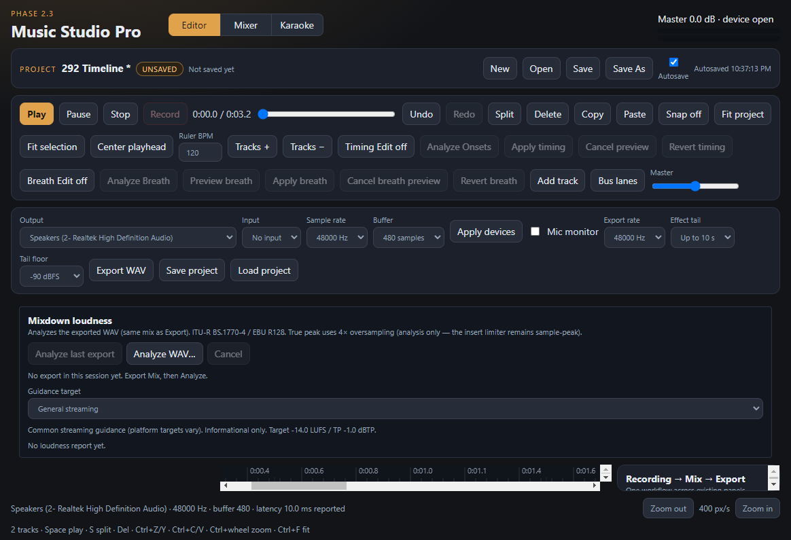

# Phase 2.9.2 — Advanced Timeline & Editing UX

**Status:** complete — STOP (await approval before Phase 2.9.3 / packaging)  
**Baseline:** Phase 2.9.1 Project Management & Autosave (approved)

## 1. Verdict

Timeline navigation, snap, multi-selection, track height, ruler readability, and clip-edit feedback were improved **in the existing renderer Timeline** (`App.tsx` + helpers). No second timeline system. **No native engine changes.** Phase 2.9.1 dirty/autosave/recovery paths remain intact.

## 2. Architecture audit (existing → reused)

| Capability | Pre-2.9.2 | 2.9.2 action |
| --- | --- | --- |
| Canvas Timeline + ruler + playhead | Present | Enhanced zoom/fit/snap/selection/ruler |
| Clip move/trim/split/duplicate/delete | Engine IPC + UI | Reused; multi-move/delete via looped commands |
| Grid snap (`placeTime`) | Zoom-step grid only | **Extended** — playhead + clip edges preferred |
| Single clip selection | Present | **Extended** — multi + marquee |
| Zoom buttons | Present | Anchor-preserving zoom; Ctrl+wheel; fit/center |
| Track height | Fixed 164px | Adjustable (Tracks +/−) |
| Bar/beat ruler | Seconds only | Display-only BPM overlay (not project schema) |
| Undo/Redo | Engine | Unchanged; edits still go through existing ops |
| Dirty / autosave (2.9.1) | Present | Preserved; selection UI does not dirty |

## 3. Existing components reused

- `Timeline` canvas in `App.tsx` (not rewritten as a new module)
- Engine `moveClip` / `trimClip` / `splitClip` / `duplicateClip` / `deleteClip` / `undo` / `redo`
- `scrollRef` / `pixelsPerSecond` / transport seek
- Phase 2.9.1 `__msp291` dirty/autosave hooks

## 4. Files changed

**Desktop:** `timelineMath.ts` (new), `App.tsx`, `styles.css`, `timelineEditing292Check.ts` (new), `main.ts`

**Native:** none

**Docs:** `docs/phase292-final-report.md`, `docs/phase292-screenshots/`

## 5. Timeline improvements

- Zoom in/out keeps an anchor time under the same viewport X (no jump)
- Ctrl/Cmd + wheel zooms toward cursor
- **Fit project**, **Fit selection**, **Center playhead**
- Ctrl+F / Ctrl+Shift+F / Ctrl+Home shortcuts
- Ruler: time labels + optional bar numbers / beat ticks from display BPM
- Snap guide line while dragging when snap is on

## 6. Editing improvements

- Marquee drag-select on empty timeline; Shift/Ctrl adds to selection
- Multi-select highlight; multi-delete / multi-split / multi-move (same delta)
- Context menu: Split / Duplicate / Delete / Clear selection
- Empty small-click seeks playhead
- Track lane height adjust + selected-track header accent

## 7. Undo / Redo & dirty-state

- Clip ops still use existing engine undo stack (one history entry per engine command)
- Multi-clip ops issue sequential commands (N undo steps) — documented limitation
- Selection / snap toggle / zoom / scroll / track height are UI-only → **not dirty**
- Meaningful edits via renderer `command()` still bump generation-based dirty; autosave still does not clear dirty

## 8. Audio safety

- No realtime-thread work; no native changes
- Playback/stop exercised in GUI check; recording hardware path NOT RUN

## 9. Backward compatibility

- Project schema unchanged (v6)
- Display BPM is local UI state only
- 2.9.1 persistence/recovery unchanged

## 10. Tests executed

```
Executed:
- npx tsc -p tsconfig.json --noEmit: exit 0
- npx tsc -p tsconfig.electron.json --noEmit: exit 0
- npm run build (desktop): exit 0
- MSP_TIMELINE_EDITING_292_CHECK=docs\phase292-screenshots: pass=31 fail=0 not_run=1
Not run: full regression, previous phase suites, native rebuild/tests (no native change), unrelated GUI checks, installer/release QA
Microphone: NOT RUN — NO HARDWARE
```

### GUI (`MSP_TIMELINE_EDITING_292_CHECK`) — 31 PASS, 1 NOT RUN

Snap targets, zoom anchor, fit/center, scroll, playhead sync, move/trim/split/duplicate/delete, undo/redo, multi-select without dirty, track height, dirty + autosave compatibility, media refs, playback safety.

NOT RUN: recording safety (hardware).




## 11. Known limitations

- Multi-clip undo is per-command (not a single grouped undo) without native batch ops
- Display BPM / bar grid is not persisted in the project file
- Per-track independent heights not implemented (global lane height)
- Snap guide approximates drag time; final commit uses full target set via `snapPlace`

## 12. Stop

Phase **2.9.2** complete. Do **not** begin Phase 2.9.3 or packaging without explicit approval.
