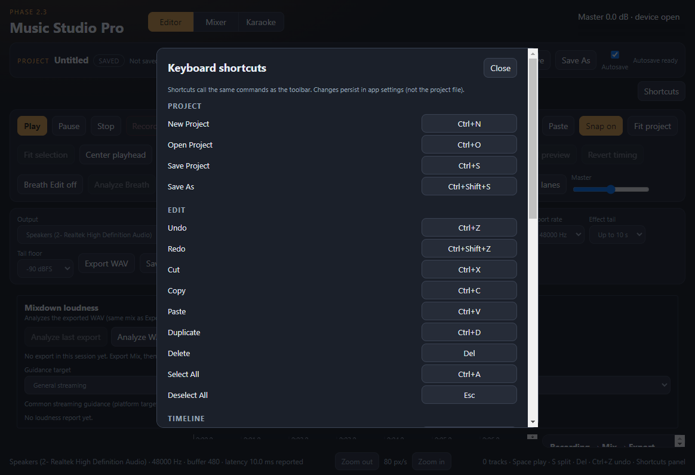
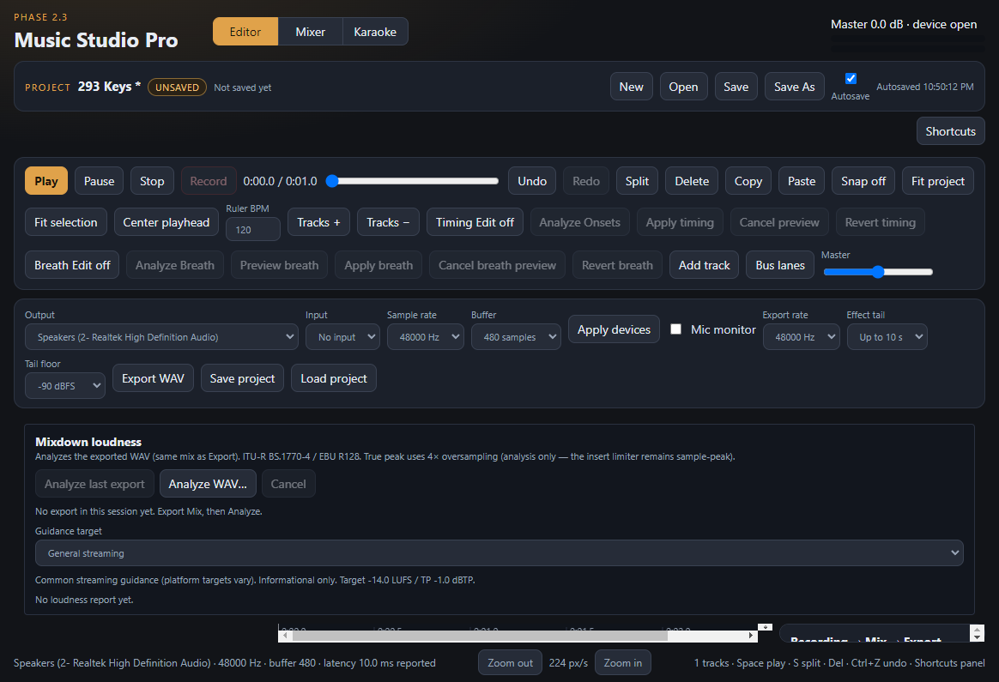

# Phase 2.9.3 — Keyboard Shortcuts & Workflow

**Status:** complete — STOP (await approval before Phase 2.9.4 / packaging)  
**Baseline:** Phase 2.9.2 Advanced Timeline & Editing UX (approved)

## 1. Verdict

Keyboard handling is centralized in one registry (`shortcuts.ts`) that routes to the **same App command functions** as toolbar buttons. Custom bindings persist in app userData (not project files). Phases 2.9.1–2.9.2 dirty/autosave/timeline behavior preserved. **No native engine changes.**

## 2. Architecture audit

| Area | Pre-2.9.3 | 2.9.3 |
| --- | --- | --- |
| Keyboard handling | Ad-hoc `window` listener in `App.tsx` | Single matcher + command dispatcher |
| Menu accelerators | None | N/A (no Electron application menu yet) |
| Shortcut prefs | None | `userData/keyboard-shortcuts.json` |
| Input focus guard | INPUT/SELECT/TEXTAREA skip | Same + contentEditable; modal/recovery guards |
| Recording safety | Partial (engine rejects unsafe transport) | Shortcut layer blocks seek/play/edit during record; Ctrl+R allowed |
| Loop / Metronome | Not in engine | Documented unavailable |
| Duplicate systems | Risk of growing ad-hoc keys | One registry only |

## 3. Existing components reused

- App project/timeline/transport helpers (`newProject`, `saveProject`, `zoomTimeline`, `splitSelected`, `toggleRecording`, …)
- Phase 2.9.1 dirty generation + autosave hooks
- Phase 2.9.2 timeline ops (fit, center, snap, multi-select)
- Engine undo/redo / transport / clip commands
- Electron userData persistence pattern (same root as recent/autosave)

## 4. Files changed

**Desktop:** `shortcuts.ts`, `ShortcutPanel.tsx`, `shortcutPrefs.ts`, `keyboardWorkflow293Check.ts`, `App.tsx`, `styles.css`, `main.ts`, `preload.ts`, `studio.d.ts`

**Native:** none

**Docs:** `docs/phase293-final-report.md`, `docs/phase293-screenshots/`

## 5. Global shortcuts (defaults)

| Command | Binding |
| --- | --- |
| New / Open / Save / Save As | Ctrl/⌘+N / O / S / Shift+S |
| Undo / Redo | Ctrl/⌘+Z / Shift+Z (also Ctrl/⌘+Y) |
| Cut / Copy / Paste / Duplicate | Ctrl/⌘+X / C / V / D |
| Delete / Select All / Deselect | Del or Backspace / Ctrl/⌘+A / Esc |

## 6. Timeline shortcuts

| Command | Binding |
| --- | --- |
| Zoom In / Out | Ctrl/⌘+= / - |
| Fit Project / Selection | Ctrl/⌘+F / Shift+F |
| Center Playhead | Ctrl/⌘+Home |
| Split / Toggle Snap | S / N |
| Nudge / Fine nudge | ←/→ / Shift+←/→ |
| Prev / Next clip | Alt+← / → |

## 7. Transport shortcuts

| Command | Binding |
| --- | --- |
| Play/Pause | Space |
| Stop | 0 |
| Record | Ctrl/⌘+R |
| Return to Start | Home |
| Seek ±1s | Ctrl/⌘+← / → |

Loop / Metronome: **not implemented** (engine has no actions).

## 8. Customization

- **Shortcuts** button → panel listing command names + bindings
- Click binding → capture keys → conflict check → save or reject
- Reset to defaults
- Persist via IPC (`shortcuts:get/set/reset`) under `{userData}/keyboard-shortcuts.json` (or `MSP_PROJECT_DATA_ROOT` in tests)

## 9. Command consistency

- One `runShortcutCommand(id)` path shared with UI actions
- Undo/Redo unchanged engine ops
- Selection / snap / zoom / panel UI → not dirty
- Clip nudge / delete / etc. → dirty via existing `command()`
- Autosave still does not clear dirty
- `event.repeat` blocked except nudge/seek; `shortcutBusy` serializes handlers
- Unsaved/recovery modals suppress global shortcuts

## 10. Audio safety

- No native/realtime-thread changes
- During recording, shortcut layer blocks play/seek/destructive edit; record toggle remains available
- Hardware recording path: NOT RUN

## 11. Tests executed

```
Executed:
- npx tsc -p tsconfig.json --noEmit: exit 0
- npx tsc -p tsconfig.electron.json --noEmit: exit 0
- npm run build (desktop): exit 0
- MSP_KEYBOARD_WORKFLOW_293_CHECK=docs\phase293-screenshots: pass=33 fail=0 not_run=3
Not run: full regression, previous phase suites, native tests (no native change), unrelated GUI checks, installer/release QA
Microphone: NOT RUN — NO HARDWARE
```

### GUI (`MSP_KEYBOARD_WORKFLOW_293_CHECK`) — 33 PASS, 3 NOT RUN

Persistence, matcher specificity, repeat blocking, panel/customization/conflicts, zoom/fit/transport/edit shortcuts, dirty + autosave, modal guard, platform meta≡ctrl.

NOT RUN: loop, metronome, recording hardware.





## 12. Known limitations

- No Electron application menu accelerators yet (renderer registry only)
- Loop / metronome unavailable until engine supports them
- Nudge left/right while snap is on uses sample-quantized deltas (not edge-snap retargeting)
- Shortcut capture rejects modifier-only keys; some exotic layouts may need manual JSON edit

## 13. Stop

Phase **2.9.3** complete. Do **not** begin Phase 2.9.4 or packaging without explicit approval.
