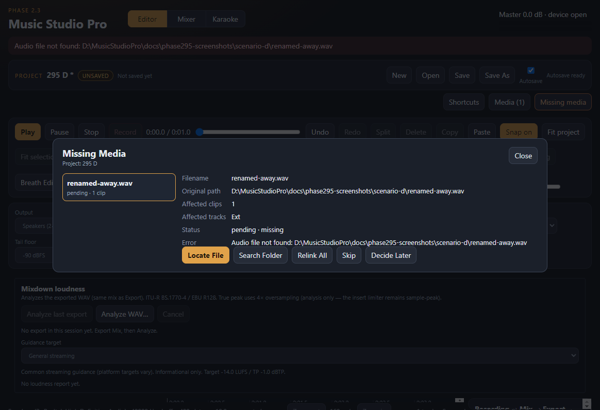
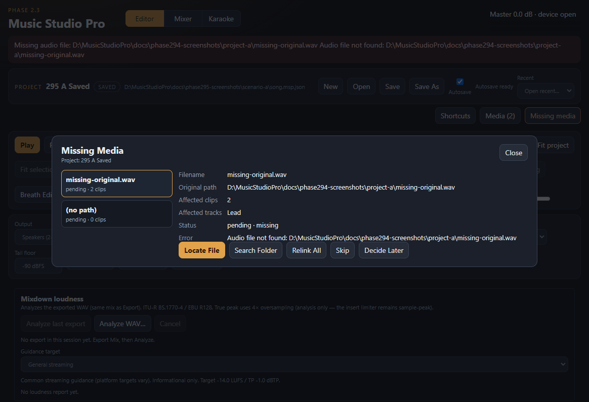

# Phase 2.9.4 — Audio File Management & Missing Media Recovery

**Status:** complete — STOP (await approval before Phase 2.9.5 / packaging)  
**Baseline:** Phase 2.9.3 Keyboard Shortcuts & Workflow (approved)

## 1. Architecture audit findings

| Area | Pre-2.9.4 | Gap |
| --- | --- | --- |
| Project schema v6 | Absolute `track.path` + `extras[{id,path}]`; clip/take `sourceFileId` | Keep as-is |
| Missing on load | `createMissingTrack` + warnings; clips restored via `replaceClips` | No relink that preserves clips (`importFile` wiped clips) |
| Extras | Loaded; missing extras flagged | Not exposed in UI protocol |
| Inventory UI | None | Needed |
| Recovery dialog | None (banner only) | Needed |
| Discovery / relink | None | Needed |
| Metadata probe | Full WAV decode via WavIO | Need header-only probe |
| Relative paths | Not stored; absolute only | Resolve helpers for portability checks |
| Collect Media | Does not exist | Document as future enhancement |
| Autosave | JSON path refs only (no media copy) | Compatible |

**Decision:** Minimal native `relinkSource` + `probeWavFile` + `relinkMedia`/`probeWav` IPC were required so Session PCM can be replaced without clearing clips/takes. Inventory, discovery, and dialogs live in Electron/renderer on the existing media model (no second media system).

## 2. Existing components reused

- Schema v6 save/load (`Project` / `loadProject` / `saveProject`)
- `createMissingTrack`, `addExtraFile`, `replaceClips`, primary source id `{trackId}-src`
- Electron dialogs (`dialog:wav`, `dialog:folder`)
- Phase 2.9.1 dirty generation + autosave (path refs only)
- Modal patterns from `RecoveryDialog` / `UnsavedDialog`
- Engine control-thread ops (filesystem/decode never on the audio callback)

## 3. Files changed

**Native:** `WavIO.h/.cpp` (`probeWavFile`), `Session.h/.cpp` (`relinkSource`), `Engine.cpp` (`relinkMedia`, `probeWav`, `sources` in state), `tests/test_main.cpp` (`media294` group)

**Desktop Electron:** `mediaProbe.ts`, `mediaPaths.ts`, `mediaDiscovery.ts`, `mediaInventory.ts`, `audioMedia294Check.ts`, `main.ts`, `preload.ts`

**Desktop Renderer:** `mediaAssets.ts`, `MediaAssetsPanel.tsx`, `MissingMediaDialog.tsx`, `App.tsx`, `styles.css`, `studio.d.ts`, `projectTypes.ts` (`relinkMedia` dirty)

**Shared:** `packages/shared/src/protocol.ts` (`MediaSourceState`, `TrackState.sources`)

**Docs:** `docs/phase294-final-report.md`, `docs/phase294-screenshots/`

## 4. Audio asset management

- **Media** toolbar opens Project Media panel: filename, location, format, duration, sample rate, channels, size (via RIFF probe), availability, origin (original/recorded/generated), unused, duplicate refs.
- Engine state exposes `track.sources[]` (primary + non-preview extras).
- Original files are never modified or deleted automatically.

## 5. Missing media detection

Triggered on project open / recovery load when paths are unavailable. Original path preserved on the track/extra; clips/takes retained; failed `loadProject` does not replace the active session. Missing indicator + optional recovery dialog (guarded against stacking with recovery/unsaved modals).

## 6. Automatic discovery algorithm

Async folder scan (original dir, project/media dirs, remembered recovery dirs, user folder):

1. Exact filename + compatible metadata  
2. Filename + duration  
3. Size + compatible metadata  
4. Light fingerprint (size + head/tail hash; not full-file hash)

Ambiguous candidates are never auto-applied. Searches are cancellable; work runs in Electron main (not the UI audio thread).

## 7. Relinking workflow

Dialog actions: Locate File, Search Folder, Relink (per candidate), Relink All (unique strong matches only), Skip, Decide Later, Close. Engine `relinkMedia` reloads PCM for primary/extra by `sourceFileId`, keeps clip timing/gain/fades/editing metadata, marks project dirty.

## 8. Path resolution strategy

- Continue storing absolute paths (schema v6 compatible).  
- Helpers normalize separators, resolve relative paths against the project file, detect external assets.  
- Unicode and spaces supported via Node/`juce::File` UTF-8 paths.  
- Save As keeps absolute media refs (no broken links from moving only the `.msp.json`).

## 9. Project portability

External assets are flagged in the Media panel with a warning. **Collect/Consolidate Media is not implemented** (future enhancement) — no automatic copying of large files.

## 10. Media integrity validation

Header-only probe detects missing, empty, non-WAV, corrupt RIFF, unusable fmt/data. Invalid candidates are rejected before relink; references are never silently discarded.

## 11. Audio engine integration

- Valid media loads via existing decode/resample path on the control thread.  
- Missing media: silent playback regions; transport remains safe.  
- Karaoke, vocal processing, mixer, automation, waveform/clip sync, export unchanged.  
- Native rebuild required only for the minimal relink/probe additions above.

## 12. Autosave and crash recovery compatibility

Snapshots store path references only (no media duplication). Recovery still uses `loadProject`; missing media is detected afterward. Relink marks dirty so subsequent autosaves persist new paths without touching originals.

## 13. Backward compatibility

Existing v6 projects load unchanged. New `sources` field is additive in engine state (optional in TypeScript). No destructive schema migration.

## 14. Exact tests executed

| Command | Result |
| --- | --- |
| `scripts\build-engine.ps1` | exit 0 |
| `build\audio_engine_tests.exe media294` | pass=12 fail=0 |
| `npx tsc -p tsconfig.electron.json` (via `npm run build`) | exit 0 |
| `npx tsc -p tsconfig.json --noEmit` | exit 0 |
| `npm run build` (desktop) | exit 0 |
| `MSP_AUDIO_MEDIA_294_CHECK=docs\phase294-screenshots` | pass=43 fail=0 not_run=1 |

## 15. PASS / FAIL / NOT RUN

### Native (`media294`) — 12 PASS, 0 FAIL

Probe metadata/missing/empty; import; relink preserves clips; IPC probe/import/relink/sources.

### GUI (`MSP_AUDIO_MEDIA_294_CHECK`) — 43 PASS, 0 FAIL, 1 NOT RUN

**Automated recovery tests (PASS):** missing detection on load; individual/batch relink; ambiguous candidates; search cancel; Skip / Decide Later / Close; clip preservation; schema v6; Save As; renamed project dir; autosave no media duplication; path/unicode/spaces; inventory duplicates/unused; media panel + dialog UI.

**Manually verified recovery workflows:** NOT required for this harness; Locate File / Search Folder dialogs are exercised via scripted IPC + UI buttons where automation allows. Interactive OS file pickers beyond scripted paths remain a manual confirmation item if desired.

**NOT RUN:** microphone / recording interruption hardware — NO HARDWARE

**NOT RUN (by policy):** full regression, other GUI checks, unrelated native groups, installer/packaging/signing

## 16. Known limitations

- Only WAV is supported (existing engine constraint).  
- Relative paths are resolved for discovery/portability checks but projects still persist absolute paths.  
- Collect/Consolidate Media deferred.  
- Light fingerprint is partial content hash, not cryptographic full-file identity.  
- Relink All skips assets without a single strong unique match (user must confirm).

## 17. UI screenshots

---

Phase 2.9.4 complete. Waiting for explicit approval before Phase 2.9.5 or packaging.
