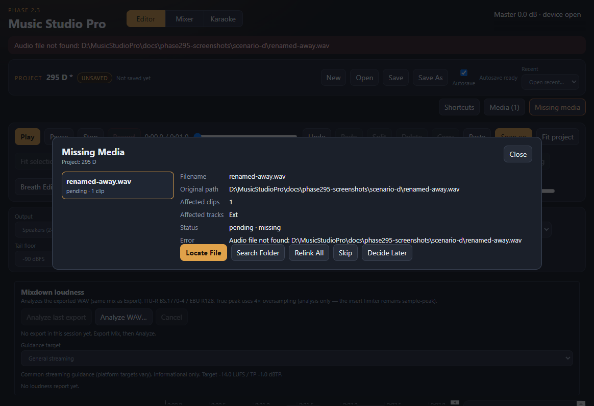
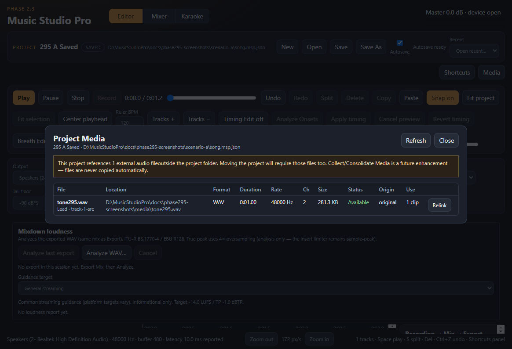
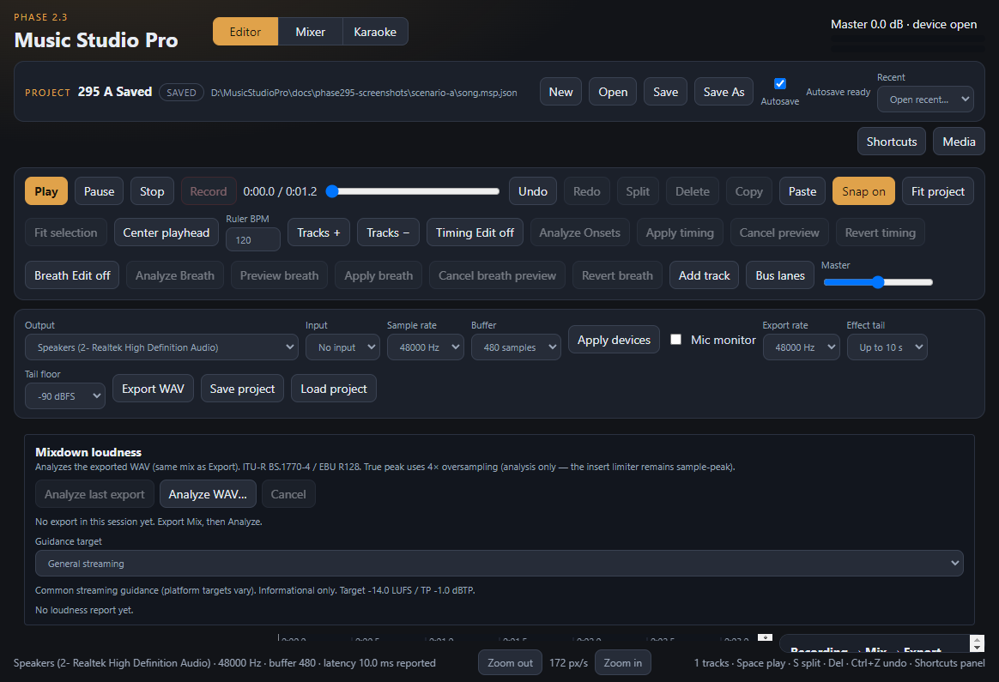

# Phase 2.9.5 — Integrated Studio Workflow

**Status:** complete — STOP (await approval before further phases / packaging)  
**Baseline:** Phases 2.9.1–2.9.4 complete and approved

## 1. Executive summary

Phase 2.9.5 integrates project management, timeline editing, keyboard commands, media recovery, and transport into one coherent workflow. No redesign and **no native engine changes**. Fixes cover dirty-state op-name alignment with real IPC, safe project switching, modal/shortcut stacking guards, stale load/`commandState` protection, synchronous dirty-ref updates, pitch/vocal dirty routing, nudge snap parity, and clipboard clear on switch.

## 2. Architecture and integration audit

| Area | Finding |
| --- | --- |
| Dirty ops (2.9.1) | `PROJECT_MUTATING_OPS` used legacy names (`importFile`, `setGain`, `setFadeIn`) while App sends `importTrack`, `setTrack`, `setClipFades`, `setMaster`, `setSend`, `record` stop, etc. → many edits never marked dirty |
| Project switch | New/Open did not stop recording/playback or clear selection/media dialogs → engine reject or leaked UI state |
| Recovery + unsaved | `askUnsaved` blocked when `recoveryOffer` was set, so dirty recovery could cancel incorrectly |
| Shortcuts | Not blocked during missing-media / media / shortcut panels |
| Stale async | Concurrent `loadProject` could apply an older response |
| Dirty ref | `projectDirtyRef` lagged React state after `bumpDirty` / mutating ops |
| Timeline / shortcuts / media / autosave cores | Already sound; reused without rewrite |

## 3. Previous-phase components reused

- 2.9.1: dirty generation, autosave snapshots, recovery dialog, recent projects, unsaved close guard  
- 2.9.2: `timelineMath`, fit/center/snap/multi-select  
- 2.9.3: `shortcuts.ts` / `runShortcutCommand`  
- 2.9.4: Media panel, missing dialog, `relinkMedia`, probe/discovery  
- Schema v6, engine transport/load/save unchanged

## 4. Integration issues identified (and fixed)

1. Dirty map mismatched real engine ops → `isProjectMutatingOp()` (including vocal-preset / note-target names)  
2. Project switch without transport/recording prep → `beginProjectSwitch` / `stopTransportForProjectSwitch`  
3. Ephemeral UI leak across projects → `resetEphemeralProjectUi` (also clears clipboard)  
4. Recovery + unsaved stacking → dismiss recovery first; `ignoreRecoveryOffer`  
5. Missing-dialog + dirty leave/quit false cancel → dismiss via guard ref before `askUnsaved`  
6. Shortcuts during modals → block when media/missing/shortcut/recovery/unsaved open  
7. Stale project open / in-flight commands → `projectSwitchToken` on load **and** `commandState`  
8. Stale dirty ref → update `projectDirtyRef` synchronously with generations  
9. Pitch/LivePitch bypassing App.command → `onProjectMutation` / `markDirtyFromExternalOp`  
10. Keyboard nudge ignored snap → uses `snapPlace` like drag  
11. Search cancel residual labels → low severity; documented, not expanded  


## 5. Files changed and reasons

| File | Reason |
| --- | --- |
| `apps/desktop/renderer/src/projectTypes.ts` | Accurate mutating/non-mutating op sets + `isProjectMutatingOp` |
| `apps/desktop/renderer/src/App.tsx` | Project switch prep, modal/quit guards, stale token on load+commandState, dirty ref sync, nudge snap, clipboard clear, `__msp295` |
| `apps/desktop/renderer/src/PitchPanel.tsx` | `onProjectMutation` for dirty routing |
| `apps/desktop/renderer/src/LivePitchPanel.tsx` | `onProjectMutation` for `setPitchMapping` |
| `apps/desktop/electron/integratedWorkflow295Check.ts` | Cross-phase integration harness |
| `apps/desktop/electron/main.ts` | Wire `MSP_INTEGRATED_WORKFLOW_295_CHECK` |
| `docs/phase295-final-report.md` | This report |
| `docs/phase295-screenshots/` | Check artifacts |

**Native:** none (no rebuild required)

## 6. Project state integration

- New/Open/Recent use `beginProjectSwitch` (stop record → stop transport → unsaved confirm → reset UI).  
- Failed `loadProject` still leaves the active project untouched.  
- Save/Save As unchanged; dirty clears only when generation matches save start.  
- Relink remains in mutating set.

## 7. Timeline and editing integration

- Selection pruned when clips disappear; cleared on project switch.  
- Undo restores clip timing and `sourceFileId` (verified in check).  
- Zoom/fit/keyboard continue to call the same helpers as toolbar actions.  
- UI-only actions still do not dirty.

## 8. Keyboard and command integration

- Single `runShortcutCommand` path retained.  
- Shortcuts suppressed while shortcut panel, media panel, missing dialog, recovery, or unsaved dialog is open.  
- Typing / recording protections unchanged.

## 9. Audio engine and transport integration

- Load/new still engine-gated while recording; renderer now stops recording first when switching.  
- Project load stops transport in engine; verified after play→load.  
- No native changes; no unnecessary engine restarts.

## 10. Media management integration

- Missing dialog closes on project switch; Decide Later leaves missing + clips intact.  
- Relink preserves clip metadata; save/reopen resolves media.  
- Collect Media remains future work.

## 11. Autosave and recovery compatibility

- Autosave still does not clear dirty; snapshots stay path-only.  
- Recovery dismisses its dialog before unsaved prompt; original project untouched.

## 12. UI/UX improvements

- Minimal: modal stacking rules, shortcut blocking with panels, consistent dirty ref.  
- No visual redesign.

## 13. Backward compatibility

- Schema v6 unchanged.  
- Existing projects load as before.  
- Additive renderer helpers only.

## 14. Tests executed (exact)

```
Executed:
- npx tsc -p tsconfig.json --noEmit: exit 0
- npx tsc -p tsconfig.electron.json --noEmit: exit 0
- npm run build (desktop): exit 0
- MSP_INTEGRATED_WORKFLOW_295_CHECK=docs\phase295-screenshots: pass=40 fail=0 not_run=2
```

### GUI (`MSP_INTEGRATED_WORKFLOW_295_CHECK`) — 40 PASS, 0 FAIL, 2 NOT RUN

Automated coverage: dirty-map alignment (incl. vocal/note-target ops); Scenarios A–E (create/edit/save, autosave, timeline/keyboard, missing media, transport switch); chrome visibility; shortcut block with media panel.

## 15. Tests not executed

| Item | Reason |
| --- | --- |
| Full regression / prior phase suites | Testing policy — not approved |
| Native tests | No native changes |
| Microphone / recording hardware switch | NOT RUN — NO HARDWARE |
| Manual crash kill + relaunch recovery | Destructive; not performed |
| Installer / packaging / signing | Out of scope |

**Manual verification:** Not claimed beyond the automated harness. Interactive OS file pickers for Locate/Search Folder are covered by prior 2.9.4 automation patterns, not re-run here as a separate manual session.

## 16. Known limitations and remaining risks

- Multi-clip edits remain N undo steps (2.9.2 limitation).  
- Collect/Consolidate Media still future.  
- Relative media persistence still absolute-path based (2.9.4).  
- Loop/metronome still unavailable (2.9.3).  
- Recording-during-switch stops the take (places audio) before leave confirm — intentional for engine safety.

## 17. Screenshots







## 18. Packaging / release

**No packaging, installer, signing, or release work was performed.**

---

Phase 2.9.5 complete. Waiting for explicit approval before any further work.
